---
## Author
author:
  name: Люпп Софья Романовна
  degrees: BSc
  orcid: 0000-0002-0877-7063
  email: 1132236039@rudn.ru
  affiliation:
    - name: Российский университет дружбы народов
      country: Российская Федерация
      postal-code: 117198
      city: Москва
      address: ул. Миклухо-Маклая, д. 6
## Title
title: Презентация по лабораторной работе №1
subtitle: Подготовка стенда и установка Julia
license: CC BY
date: today
date-format: "YYYY-MM-DD" # Example: 2025-09-06
---

# Информация

## Докладчик

:::::::::::::: {.columns align=center}
::: {.column width="70%"}

  * Люпп Софья Романовна
  * студентка группы НКНбд-01-23
  * кафедра теории вероятностей и кибербезопасности
  * Российский университет дружбы народов им. П. Лумумбы
  * [1132236039@rudn.ru]
  * <https://github.com/srluipp>

:::
::: {.column width="30%"}

:::
::::::::::::::

# Вводная часть

## Актуальность

Julia актуальна как инструмент для научных вычислений, финансового моделирования, искусственного интеллекта, вычислений в области инженерии и физики, благодаря своей высокой производительности, простоте синтаксиса и гибкости в работе с массивами и параллельным программированием

## Объект и предмет исследования

Julia является обьектом и предметом исследования

## Цели и задачи

Цель данной лабораторной работы - приобретение практических навыков работы с системой управления версиями Git, языком программирования Julia.

# Выполнение лабораторной работы

Начинаю с подготовки и настройки рабочего пространства (установка git), котоая у меня уже была, перехожу к созданию ключей ssh ([рис. @fig-001]).

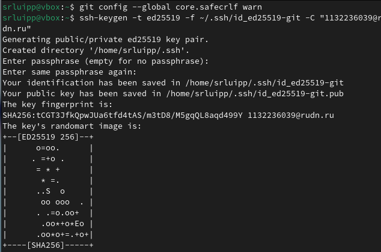{#fig-001 width=70%}

## Настройка ключей ssh

([рис. @fig-002])

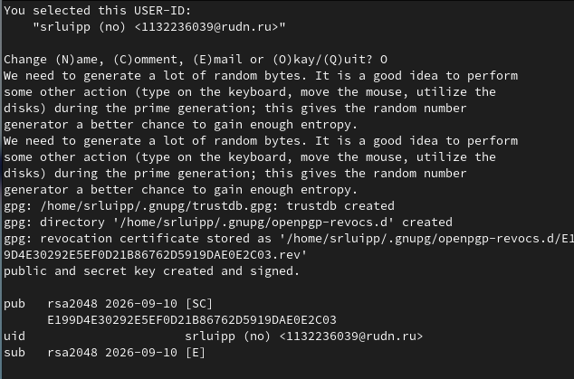{#fig-002 width=70%}

## Настройка ключей ssh

([рис. @fig-003])

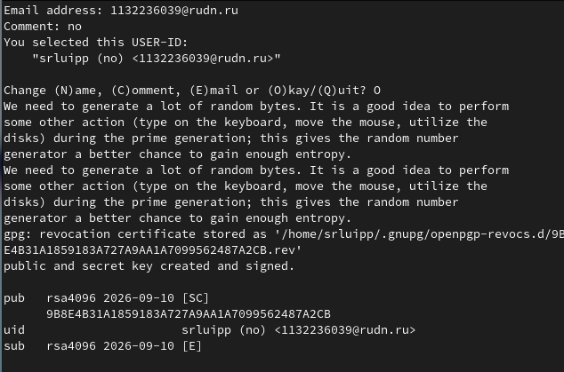{#fig-003 width=70%}

## Настройка ключей ssh

([рис. @fig-004]) 

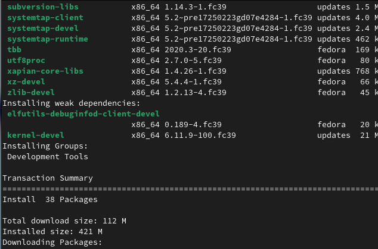{#fig-004 width=70%}

##  libxcrypt-compact

Устанавливаю библиотеку libxcrypt-compact([рис. @fig-005]).
 
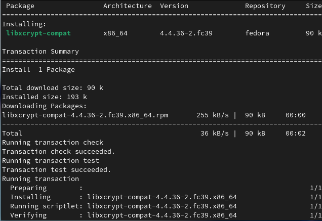{#fig-005 width=70%}

## quarto

Устанавливаю quarto ([рис. @fig-006]) 

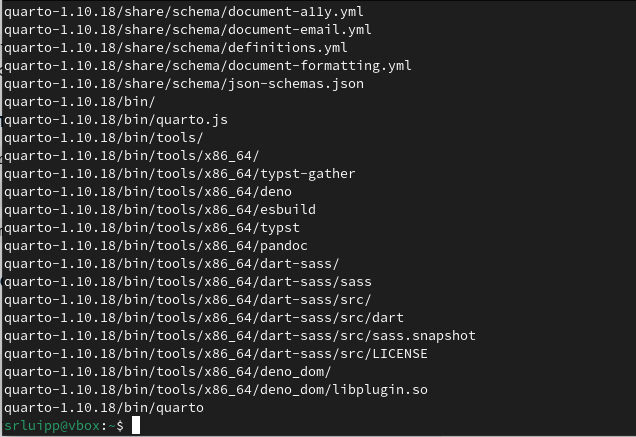{#fig-006 width=70%}

## quarto

(рис. @fig-007])

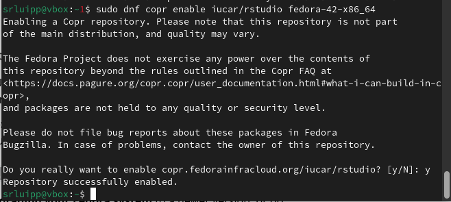{#fig-007 width=70%}

## 

Устанавливаю node.js ([рис. @fig-008]).

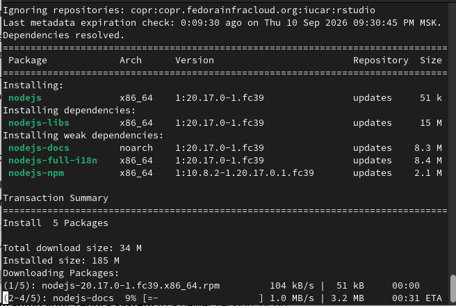{#fig-008 width=70%}

##
Устанавливаю pnpm([рис. @fig-009]).

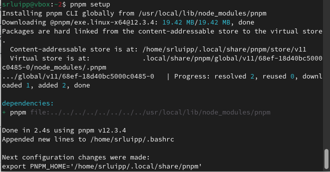{#fig-009 width=70%}

Устанавливаю pnpm commitzens ([рис. @fig-010]) 

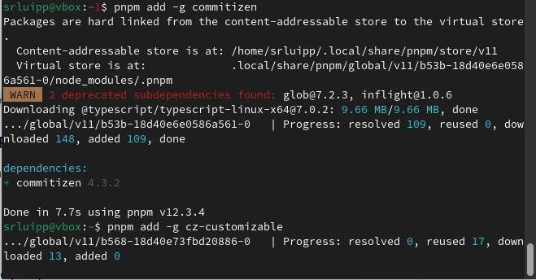{#fig-010 width=70%}

##
([рис. @fig-011])

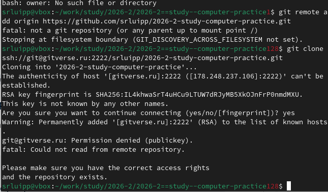{#fig-011 width=70%}

##

Клонирую репозиторий в GitVerse([рис. @fig-012])  

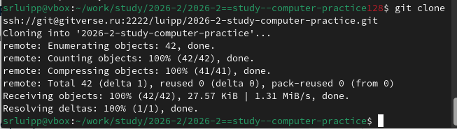{#fig-012 width=70%}

##

([рис. @fig-013])

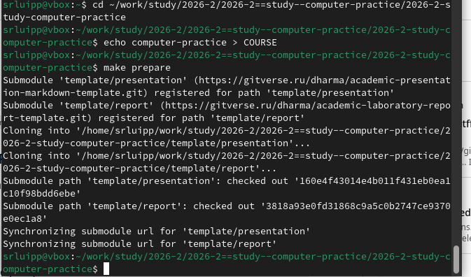{#fig-013 width=70%}

##
Произвожу команды make и пушу на гит([рис. @fig-014])

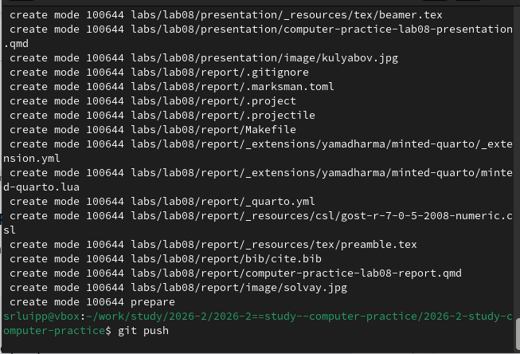{#fig-014 width=70%}

##
([рис. @fig-015])

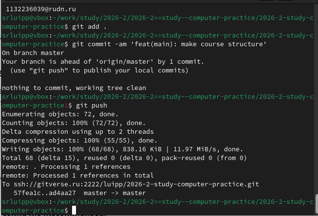{#fig-015 width=70%}

##

Теперь необходимо установить и распаковать gitflow  ([рис. @fig-016])

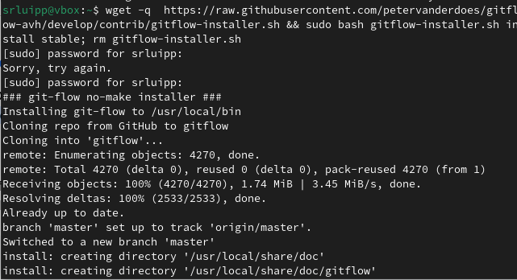{#fig-016 width=70%}

##
([рис. @fig-017])
 
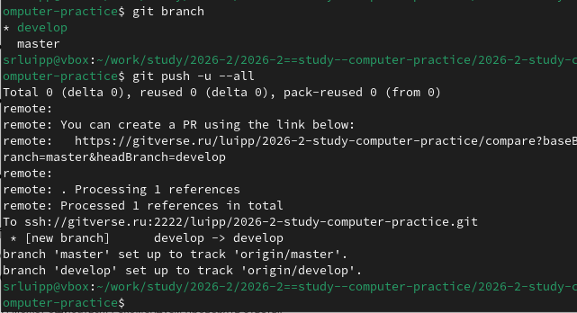{#fig-017 width=70%}

##
Настройка branches ([рис. @fig-018]).

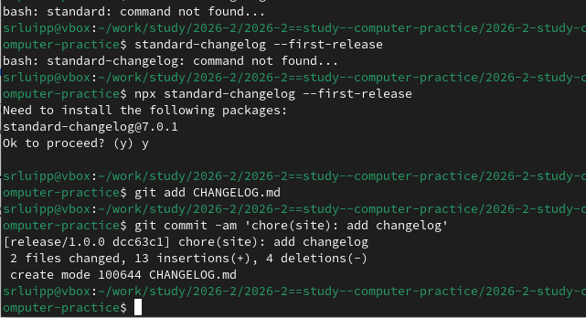{#fig-018 width=70%}

##
Checking the branches ([рис. @fig-019]) 

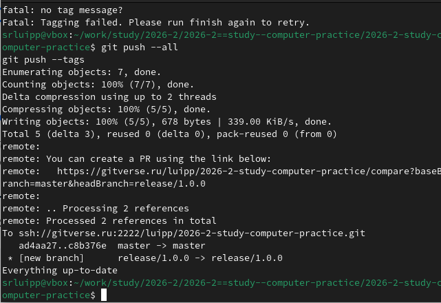{#fig-019 width=70%}

##
([рис. @fig-020])

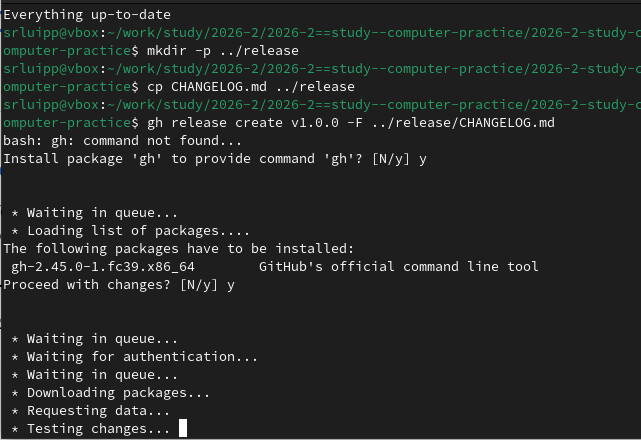{#fig-020 width=70%}

##
Устанавливаю пакет julia ([рис. @fig-021]).

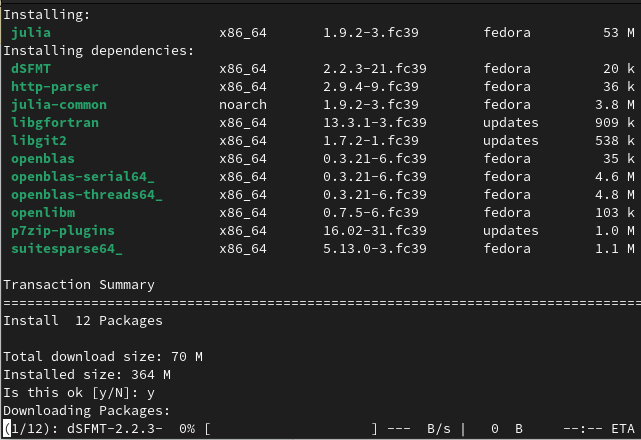{#fig-021 width=70%}

##
 Устанавливаю необходимые дополнения для julia ([рис. @fig-022]) 

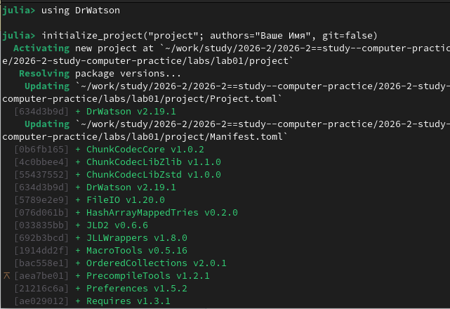{#fig-022 width=70%}

##
([рис. @fig-023])

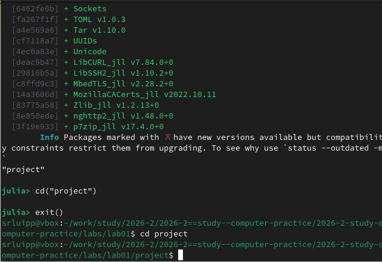{#fig-023 width=70%}

##
([рис. @fig-024]) 

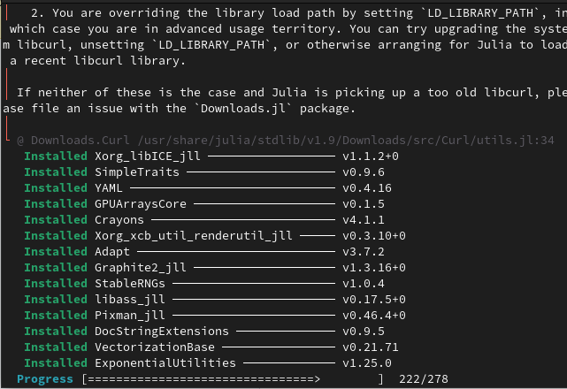{#fig-024 width=70%}

# Выводы

В ходе лабораторной работы я приобрела практические навыки работы с системой управления версиями Git, языком программирования Julia. 

