---
## Author
author:
  name: Люпп Софья Романовна
  degrees: BSc
  orcid: 0000-0002-0877-7063
  email: kulyabov-ds@rudn.ru
  affiliation:
    - name: Российский университет дружбы народов
      country: Российская Федерация
      postal-code: 117198
      city: Москва
      address: ул. Миклухо-Маклая, д. 6

## Title
title: "Лабораторная работа №1"
subtitle: ""
license: "CC BY"
---

# Цель работы

Цель данной лабораторной работы - приобретение практических навыков работы с системой управления версиями Git, языком программирования Julia.

# Задание

1.	Выполнить задания из лабораторной работы
2.	Оформить отчет по лабораторной работе с помощью Markdown
3.      Выполнить домашнюю работу

# Теоретическое введение

Системы контроля версий (Version Control System, VCS) применяются при работе
нескольких человек над одним проектом. Обычно основное дерево проекта
хранится в локальном или удалённом репозитории, к которому настроен доступ для участников проекта. При внесении изменений в содержание проекта
система контроля версий позволяет их фиксировать, совмещать изменения,
произведённые разными участниками проекта, производить откат к любой
более ранней версии проекта, если это требуется.

Системы контроля версий также могут обеспечивать дополнительные, более
гибкие функциональные возможности. Например, они могут поддерживать
работу с несколькими версиями одного файла, сохраняя общую историю изменений до точки ветвления версий и собственные истории изменений каждой
ветви. Кроме того, обычно доступна информация о том, кто из участников,
когда и какие изменения вносил. Обычно такого рода информация хранится в
журнале изменений, доступ к которому можно ограничить.

1.2.1.4 Создание ключа ssh
1. Общая информация
1. Алгоритмы шифрования ssh
1. Аутентификация
В SSH поддерживается четыре алгоритма аутентификации по открытым ключам:
— DSA:
— размер ключей DSA не может превышать 1024, его следует отключить;
— RSA:
— следует создавать ключ большого размера: 4096 бит;
— ECDSA:
— ECDSA завязан на технологиях NIST, его следует отключить;
— Ed25519:
— используется пока не везде.

По умолчанию пользовательские ssh-ключи сохраняются в каталоге
~/.ssh в домашнем каталоге пользователя.

Создание ключа ssh
— Ключ ssh создаётся командой:
ssh-keygen -t <алгоритм>

1.2.2.5.1 Основные ветки (master) и ветки разработки (develop)
Для фиксации истории проекта в рамках этого процесса вместо одной ветки
master используются две ветки. В ветке master хранится официальная история
релиза, а ветка develop предназначена для объединения всех функций. Кроме
того, для удобства рекомендуется присваивать всем коммитам в ветке master
номер версии.

1.2.2.5.2 Функциональные ветки (feature)

Под каждую новую функцию должна быть отведена собственная ветка, которую можно отправлять в центральный репозиторий для создания резервной
копии или совместной работы команды. Ветки feature создаются не на основе
master, а на основе develop. Когда работа над функцией завершается, соответствующая ветка сливается обратно с веткой develop. Функции не следует
отправлять напрямую в ветку master.
Как правило, ветки feature создаются на основе последней ветки develop.

2.1 Литературное (грамотное) программирование — это подход, приоритизирующий
понятность программы для человека, а не её исполнение компьютером. В экосистеме Julia он реализуется через несколько инструментов. Предлагается использовать Literate.jl.

Идея, предложенная Дональдом Кнутом [1—3], меняет традиционный взгляд: программа создаётся не как последовательность инструкций для машины, а как литературное эссе, объясняющее логику решения задачи.

— Literate.jl отлично подходит для автоматизации создания документации, а
также для написания статей и учебников прямо в .jl-файлах.
— Weave.jl больше заточен под академические отчёты и публикации, требующие
строгого форматирования (LaTeX/PDF).
— Jupyter лучше подходит для интерактивного исследования данных, но управление версиями .ipynb-файлов и их автоматизация сложнее.

# Выполнение лабораторной работы

Начинаю с подготовки и настройки рабочего пространства (установка git), котоая у меня уже была, перехожу к созданию ключей ssh ([рис. @fig-001]).

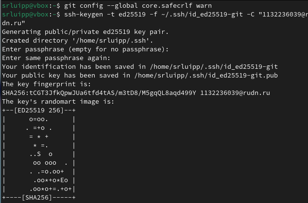{#fig-001 width=70%}

Настройка ключей ssh([рис. @fig-002])([рис. @fig-003])([рис. @fig-004]) .

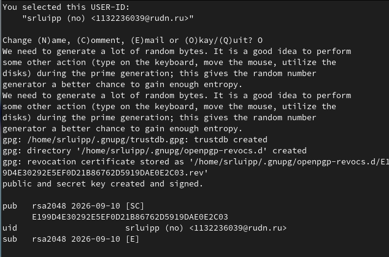{#fig-002 width=70%}

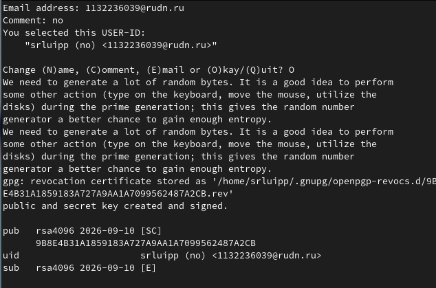{#fig-003 width=70%}

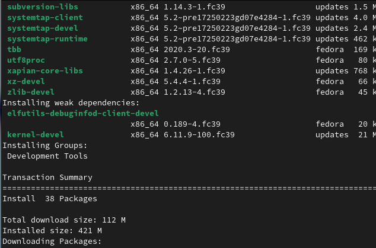{#fig-004 width=70%}

 Устанавливаю библиотеку libxcrypt-compact([рис. @fig-005]).
 
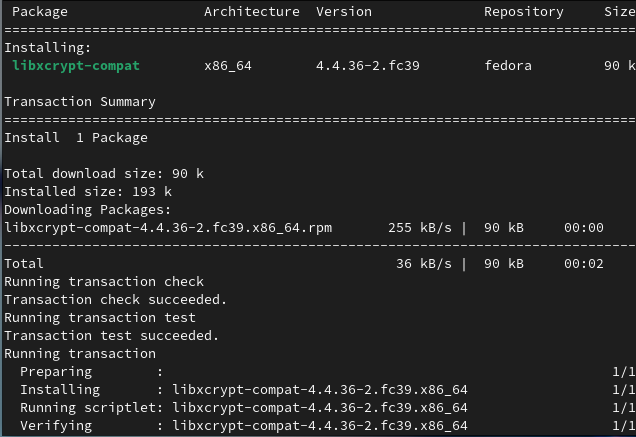{#fig-005 width=70%}

Устанавливаю quarto ([рис. @fig-006]) (рис. @fig-007]).

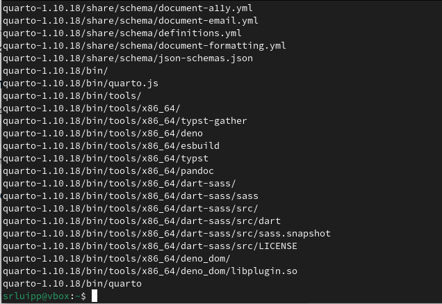{#fig-006 width=70%}

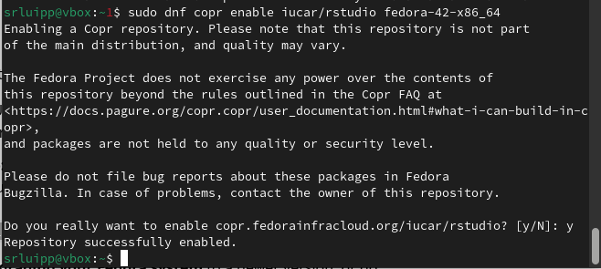{#fig-007 width=70%}

Устанавливаю node.js ([рис. @fig-008]).

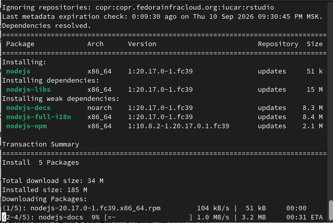{#fig-008 width=70%}

 Устанавливаю pnpm([рис. @fig-009]).

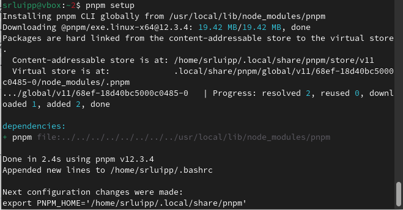{#fig-009 width=70%}

Устанавливаю pnpm commitzens ([рис. @fig-010]) ([рис. @fig-011])..

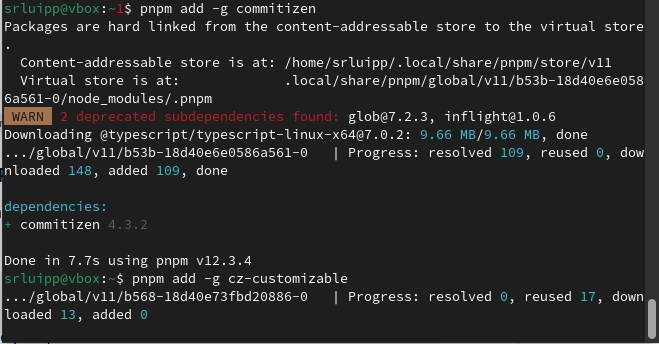{#fig-010 width=70%}

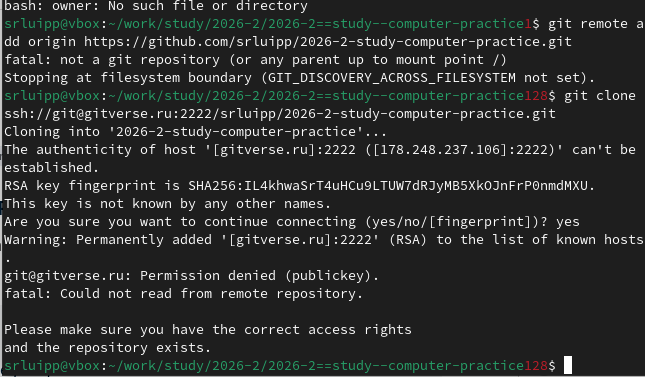{#fig-011 width=70%}

Клонирую репозиторий в GitVerse([рис. @fig-012])  ([рис. @fig-013])..

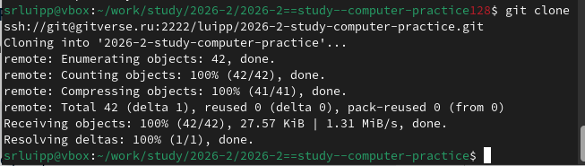{#fig-012 width=70%}

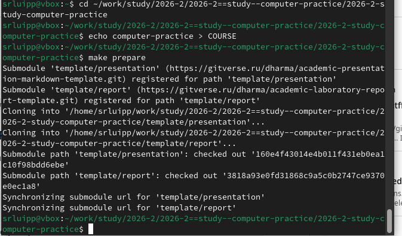{#fig-013 width=70%}

Произвожу команды make и пушу на гит([рис. @fig-014])([рис. @fig-015]).

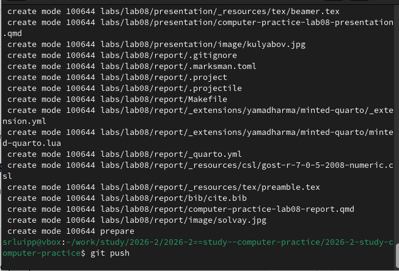{#fig-014 width=70%}

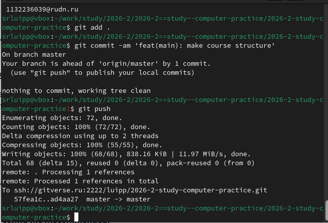{#fig-015 width=70%}

Теперь необходимо установить и распаковать gitflow  ([рис. @fig-016]) ([рис. @fig-017]).

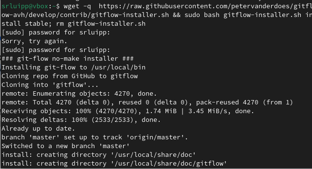{#fig-016 width=70%}

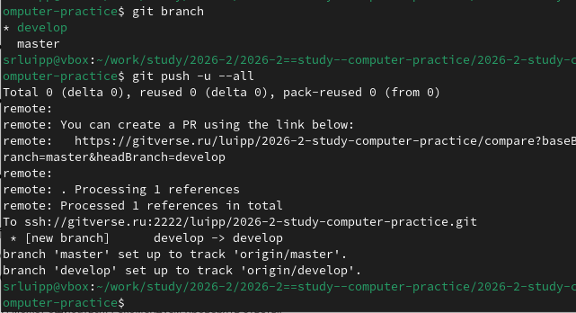{#fig-017 width=70%}

Настройка branches ([рис. @fig-018]).

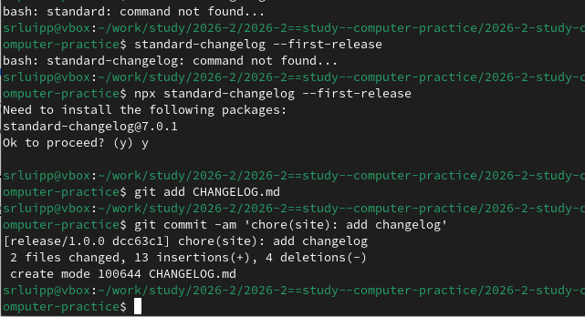{#fig-018 width=70%}

Checking the branches ([рис. @fig-019]) ([рис. @fig-020]).

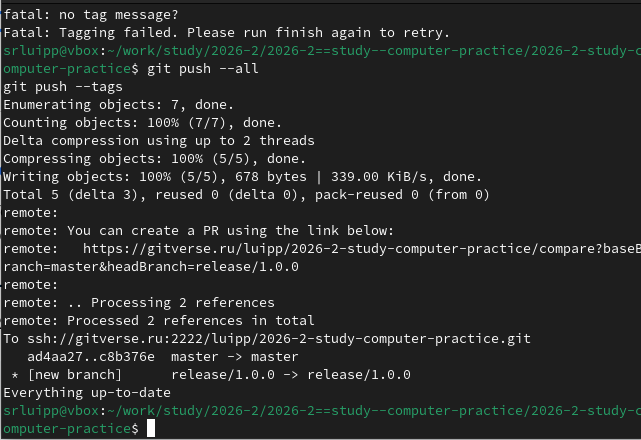{#fig-019 width=70%}

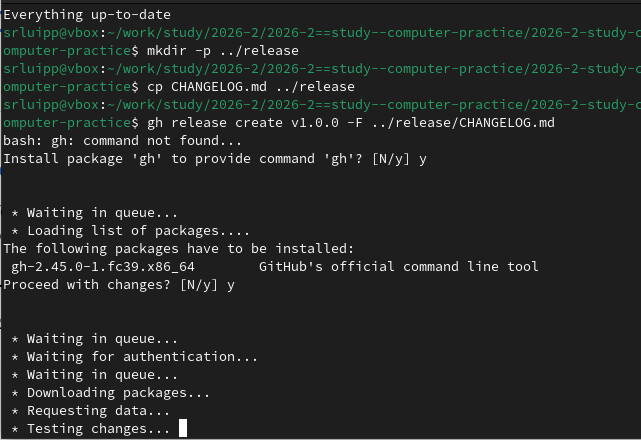{#fig-020 width=70%}

Устанавливаю пакет julia ([рис. @fig-021]).

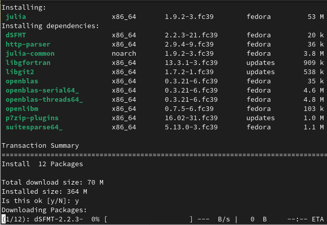{#fig-021 width=70%}

 Устанавливаю необходимые дополнения для julia ([рис. @fig-022])([рис. @fig-023]) ([рис. @fig-024]) .

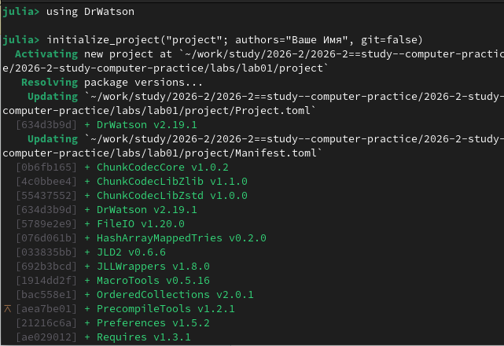{#fig-022 width=70%}

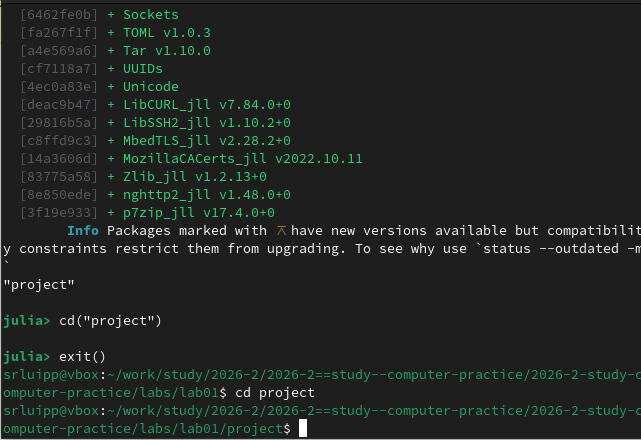{#fig-023 width=70%}

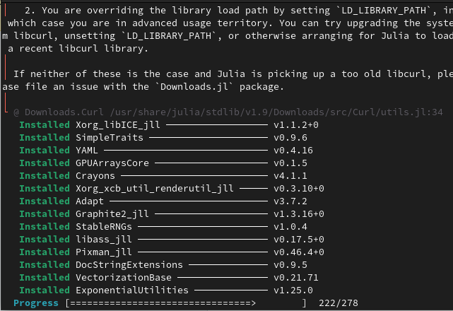{#fig-024 width=70%}

# Выводы

В ходе лабораторной работы я приобрела практические навыки работы с системой управления версиями Git, языком программирования Julia. 

# Список литературы{.unnumbered}

- Имитационное моделирование. Практикум
А. В. Королькова Кулябов Д. С.
::: {#refs}
:::
