---
## Author
author:
  name: Люпп Софья Романовна
  degrees: BSc
  orcid: 0000-0002-0877-7063
  email: 1132236039@rudn.ru
  affiliation:
    - name: Российский университет дружбы народов
      country: Российская Федерация
      postal-code: 117198
      city: Москва
      address: ул. Миклухо-Маклая, д. 6
## Title
title: Презентация по лабораторной работе №2
subtitle: Структура данных
license: CC BY
date: today
date-format: "YYYY-MM-DD" # Example: 2025-09-06
---

# Информация

## Докладчик

:::::::::::::: {.columns align=center}
::: {.column width="70%"}

  * Люпп Софья Романовна
  * студентка группы НКНбд-01-23
  * кафедра теории вероятностей и кибербезопасности
  * Российский университет дружбы народов им. П. Лумумбы
  * [1132236039@rudn.ru]
  * <https://github.com/srluipp>

:::
::: {.column width="30%"}

:::
::::::::::::::

# Вводная часть

## Актуальность

Julia актуальна как инструмент для научных вычислений, финансового моделирования, искусственного интеллекта, вычислений в области инженерии и физики, благодаря своей высокой производительности, простоте синтаксиса и гибкости в работе с массивами и параллельным программированием

## Объект и предмет исследования

Язык программирования Julia и среда JupyterLab

## Цели и задачи

Основная цель работы — изучить несколько структур данных, реализованных в Julia,
научиться применять их и операции над ними для решения задач.

# Выполнение лабораторной работы

Начинаю с подготовки и настройки рабочего пространства (установка JupyterLab с выбранным языком программирования Julia),([рис. @fig-001]).

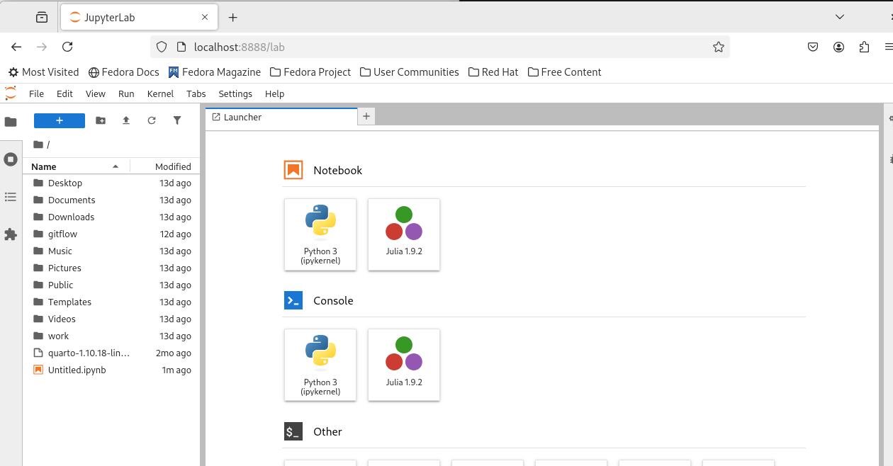{#fig-001 width=70%}

## Задания лабораторной работы

Начинаю поэтапно выполнять задания лабораторной работы. Для задания №1 нахожу пересечения множество с помощью оператора Set()([рис. @fig-002])

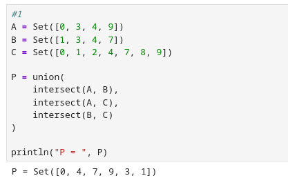{#fig-002 width=70%}

## Задание 2

Далее привожу свои примеры операций над множествами элементов разных типов ([рис. @fig-003])

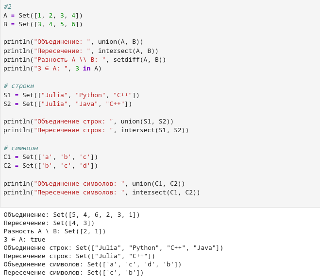{#fig-003 width=70%}

## Методы isempty(), reduce(), minimum() и другие

Привожу пример исполнения метода isempty(), reduce(), minimum() и других методов, создав массивы для каждого метода и выводя получившиеся результаты([рис. @fig-004]) 

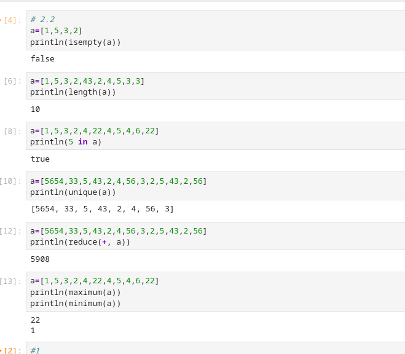{#fig-004 width=70%}

## Задание №3

Выполняю задание 3.1, где вывожу вектор, состоящий из последовательных значений от 1 до 25 ([рис. @fig-005]).
 
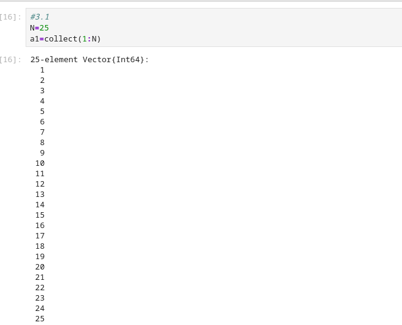{#fig-005 width=70%}

## 3.2

Вывожу тот же вектор только со значениями, заданными в обратной последовательности ([рис. @fig-006]) 

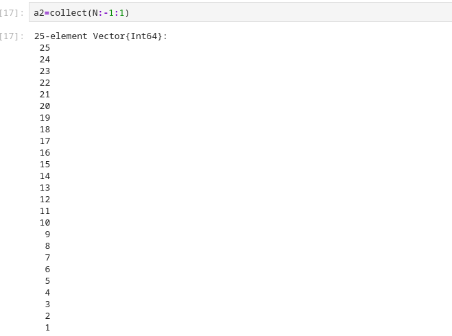{#fig-006 width=70%}

## 3.3

При помощи collect() создаю вектор со значениями от 1 до 25 и обратно, от 24 до 1 (рис. @fig-007])

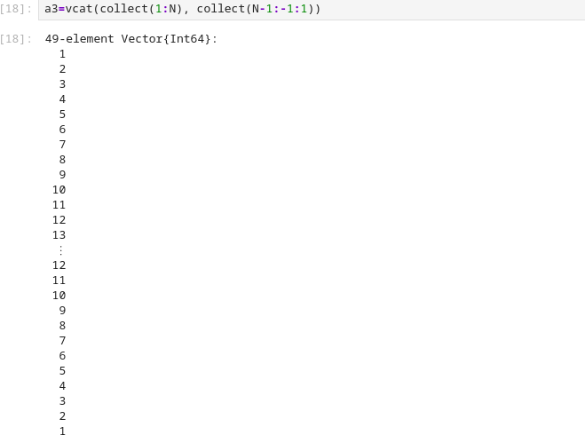{#fig-007 width=70%}

## 3.4

Создаю вектор tmp с заданными значениями ([рис. @fig-008]).

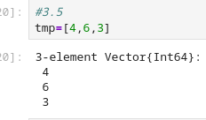{#fig-008 width=70%}

## 3.5

Повторяю первую компоненту вектора tmp 10 раз ([рис. @fig-009]).

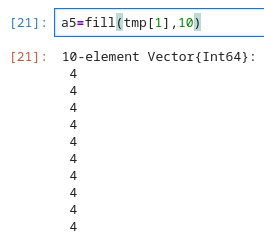{#fig-009 width=70%}

## 3.6

Повторяю все элементы вектора tmp 10 раз([рис. @fig-010]) 

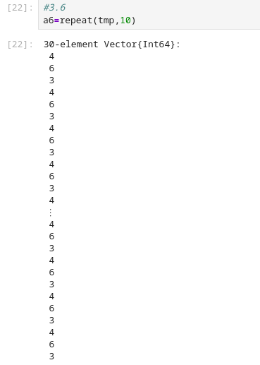{#fig-010 width=70%}

## 3.7

Повтряю каждое из значений вектора tmp некоторое количество раз([рис. @fig-011])

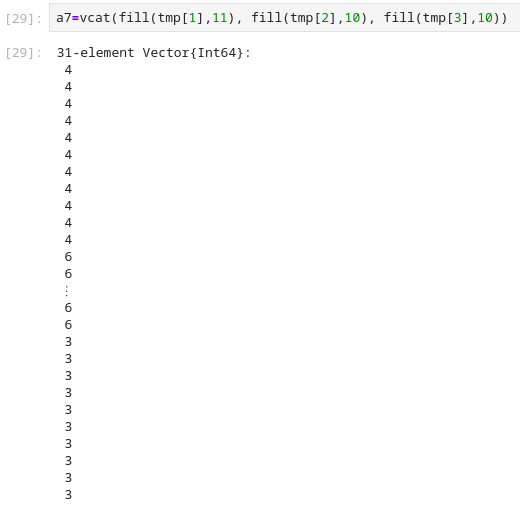{#fig-011 width=70%}

## 3.8

Аналогично повторяю компоненты вектора tmp несколько раз по заданию ([рис. @fig-012])  

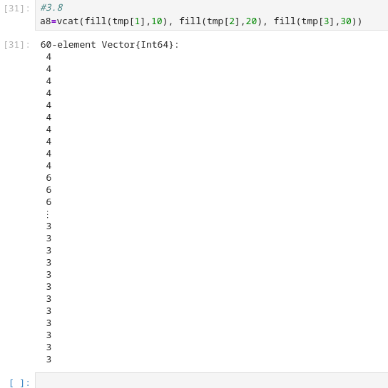{#fig-012 width=70%}

## 3.9

Вывожу вектор, компоненты которого заданы степенной функцией ([рис. @fig-013])

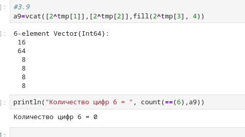{#fig-013 width=70%}

## 3.10

Вывожу вектор значений y, который задан Функцией cos(x) с заданными узлами ([рис. @fig-014])

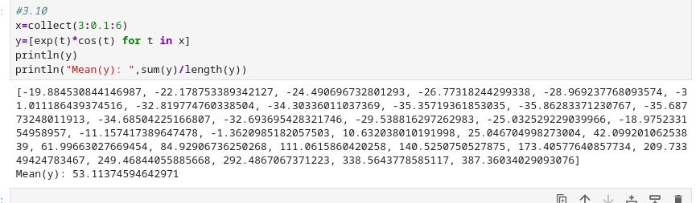{#fig-014 width=70%}

## 3.11 
Вывожу вектор вида (𝑥𝑖, 𝑦𝑗) с узлами в заданных точках по заданию ([рис. @fig-015])

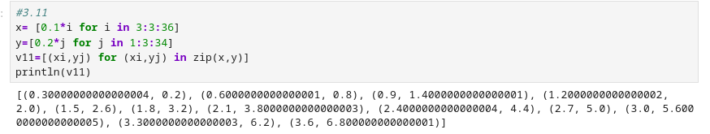{#fig-015 width=70%}

## 3.12

Вывожу вектор с элементами вида 2i/i с заданными точками([рис. @fig-016])

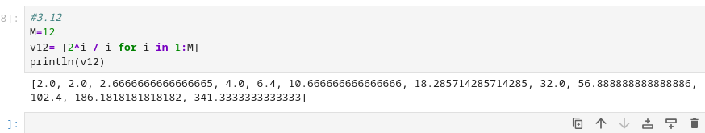{#fig-016 width=70%}

## 3.13

Вывожу вектор вида fni со значениями от 1 до 30 ([рис. @fig-017])
 
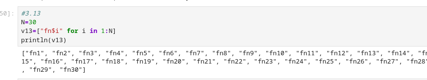{#fig-017 width=70%}

## 3.14
Вывожу векторы 𝑥 = (𝑥1, 𝑥2, … , 𝑥𝑛) и 𝑦 = (𝑦1, 𝑦2, … , 𝑦𝑛) целочисленного типа длины
𝑛 = 250 как случайные выборки из совокупности 0, 1, … , 999 ([рис. @fig-018]).

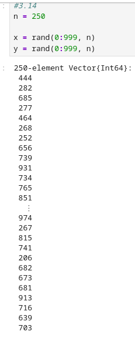{#fig-018 width=70%}

## 3.14

Формирую вектор (𝑦2 − 𝑥1, … , 𝑦𝑛 − 𝑥𝑛−1), вектор с косинусами и синусами и вектор суммы ([рис. @fig-019]) 

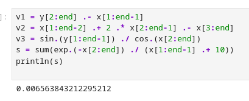{#fig-019 width=70%}

## 3.14

Выбераю элементы вектора 𝑦, значения которых больше 600 и определяю индексы эолементов ([рис. @fig-020])

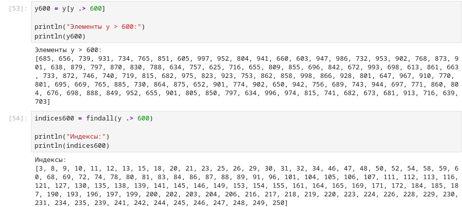{#fig-020 width=70%}

## 3.14 

Определяю значения вектора 𝑥, соответствующие значениям вектора 𝑦, значения которых больше 600 и в следующем пункте формирую вектор из средний значений компонент вектора ([рис. @fig-021]).

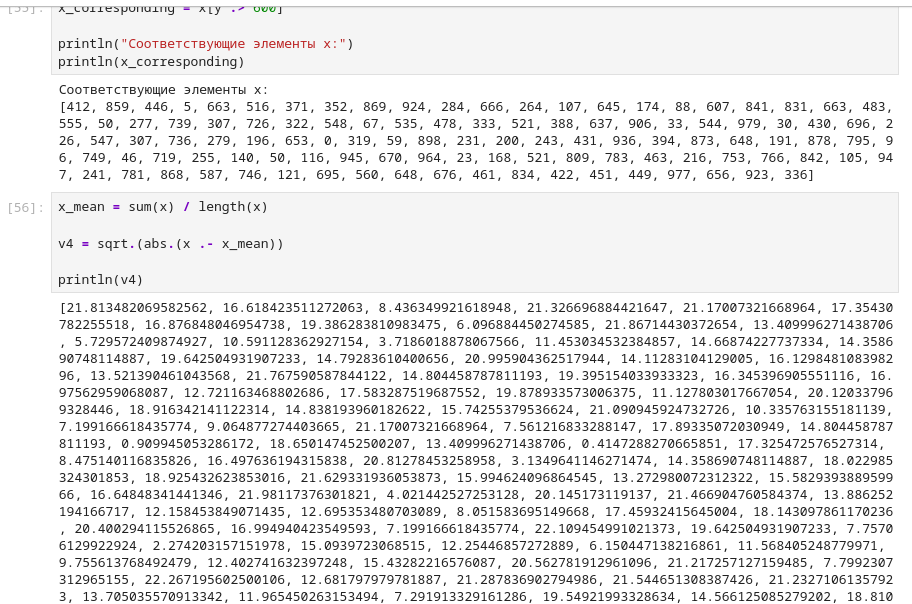{#fig-021 width=70%}

## 3.14

Определяю, сколько элементов вектора 𝑦 отстоят от максимального значения не более, чем на 200; чётныe и нечётныe элементы вектора; сколько элементов кратны 7 и сортирую элементы 𝑥 в порядке возрастания элементов 𝑦 ([рис. @fig-022]) ([рис. @fig-023])

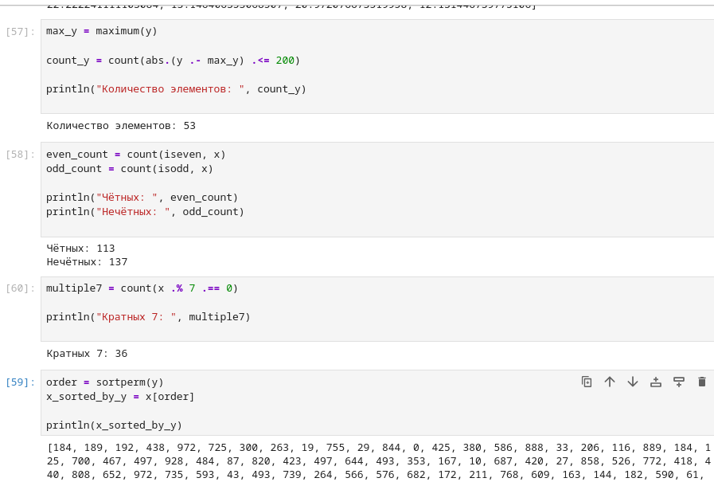{#fig-022 width=70%}

## 3.14

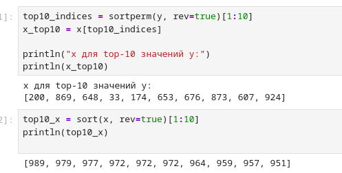{#fig-023 width=70%}

## 3.14

Вывожу вектор только с уникальными значениями этого вектора ([рис. @fig-024]) 

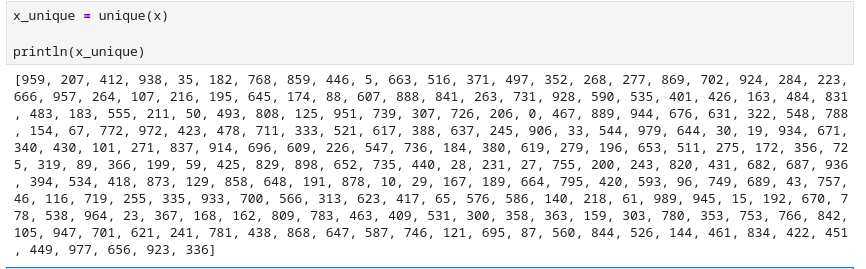{#fig-024 width=70%}

## 4

Создаю массив squares, в котором будут храниться квадраты всех целых чисел от 1
до 100 ([рис. @fig-025]) 

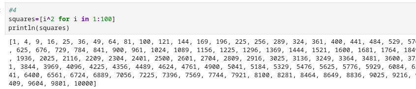{#fig-025 width=70%}

## 5

Устанавливаю пакет Primes через Julia и генерирую массив первых 168 простых чисел ([рис. @fig-026]) ([рис. @fig-027]) 

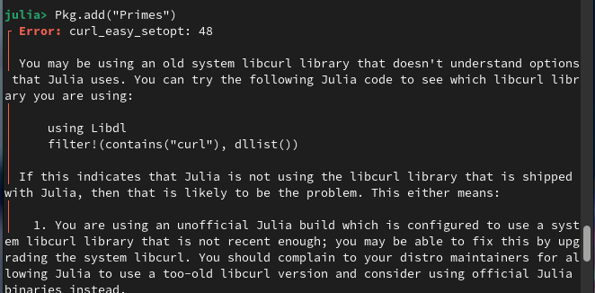{#fig-026 width=70%}

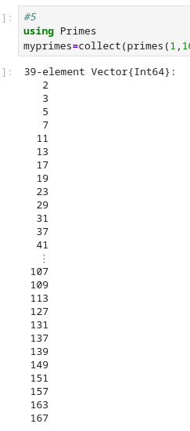{#fig-027 width=70%}

## 6

Определяю 89 наименьшее простое число ([рис. @fig-028]) 

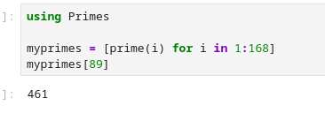{#fig-028 width=70%}

## 6

Получаю срез массива от 89 до 99 элемента, содержащих наименьшие простые числа ([рис. @fig-029]) 

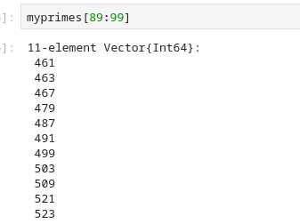{#fig-029 width=70%}

## 6

Вычисляю выражения ([рис. @fig-030]) 

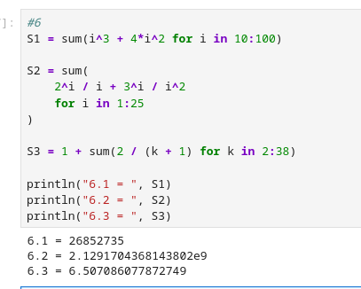{#fig-030 width=70%}

# Выводы

В результате получился ipynb файл с выполненными заданиями на языке Julia, выполняя которые мы получили навыки работы с языком программирования и структурами данных в среде программирования JupyterLab
