---
## Author
author:
  name: Люпп Софья Романовна
  degrees: BSc
  orcid: 0000-0002-0877-7063
  email: 1132236039@rudn.ru
  affiliation:
    - name: Российский университет дружбы народов
      country: Российская Федерация
      postal-code: 117198
      city: Москва
      address: ул. Миклухо-Маклая, д. 6
## Title
title: Презентация по лабораторной работе №3
subtitle: Управляющие структуры
license: CC BY
date: today
date-format: "YYYY-MM-DD" # Example: 2025-09-06
---

# Информация

## Докладчик

:::::::::::::: {.columns align=center}
::: {.column width="70%"}

  * Люпп Софья Романовна
  * студентка группы НКНбд-01-23
  * кафедра теории вероятностей и кибербезопасности
  * Российский университет дружбы народов им. П. Лумумбы
  * [1132236039@rudn.ru]
  * <https://github.com/srluipp>

:::
::: {.column width="30%"}

:::
::::::::::::::

# Вводная часть

## Актуальность

Julia актуальна как инструмент для научных вычислений, финансового моделирования, искусственного интеллекта, вычислений в области инженерии и физики, благодаря своей высокой производительности, простоте синтаксиса и гибкости в работе с массивами и параллельным программированием

## Объект и предмет исследования

Язык программирования Julia и среда JupyterLab

## Цели и задачи

Основная цель работы — освоить применение циклов функций и сторонних для Julia
пакетов для решения задач линейной алгебры и работы с матрицами.

# Выполнение лабораторной работы

Начинаю работу с воспроизведения результатов примеров из задания 3.2, в примерах 1 и 2 задания на циклы for и while([рис. @fig-001]).

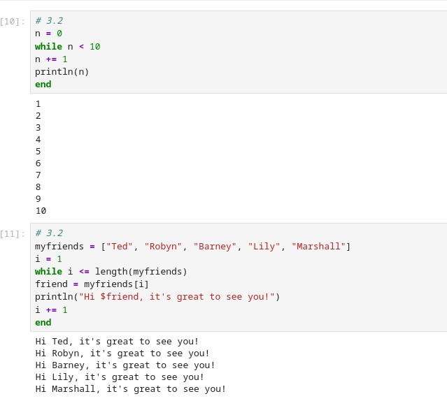{#fig-001 width=70%}

## Задания лабораторной работы

Воспроизвожу еще один пример с for и пример работы с матрицами через индексы i j ([рис. @fig-002])

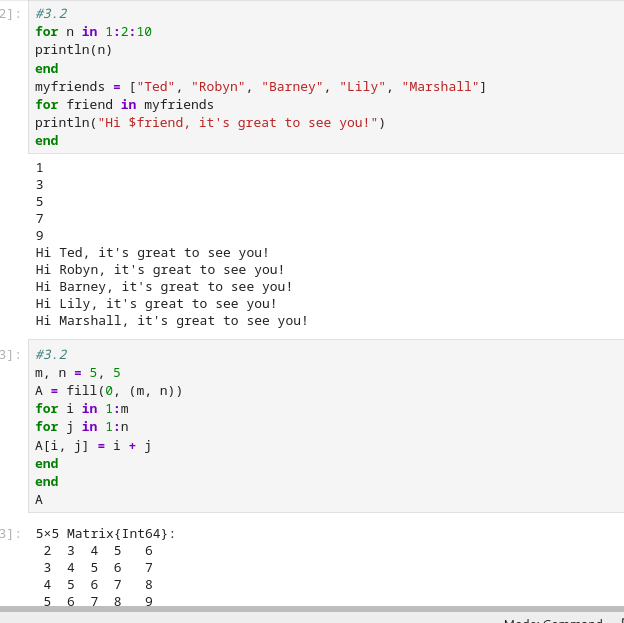{#fig-002 width=70%}

## Задания лабораторной работы

Далее привожу примеры вывода матриц разными способами ([рис. @fig-003])

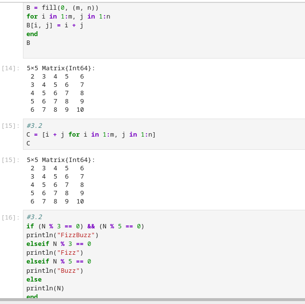{#fig-003 width=70%}

## Задания лабораторной работы

Привожу пример работы функций, а так же работы sort ([рис. @fig-004]) 

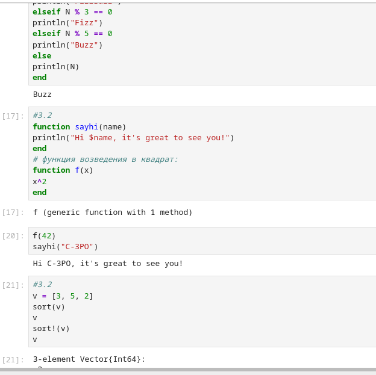{#fig-004 width=70%}

## Задания лабораторной работы

Выполняю пример функций для вывода матриц ([рис. @fig-005]).
 
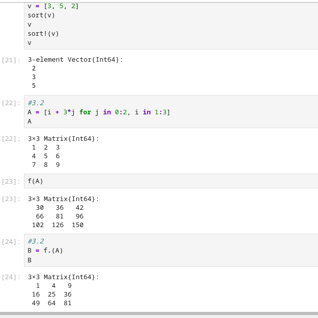{#fig-005 width=70%}

## Задания лабораторной работы

Выполняю пример функций для вывода матриц ([рис. @fig-006]) 

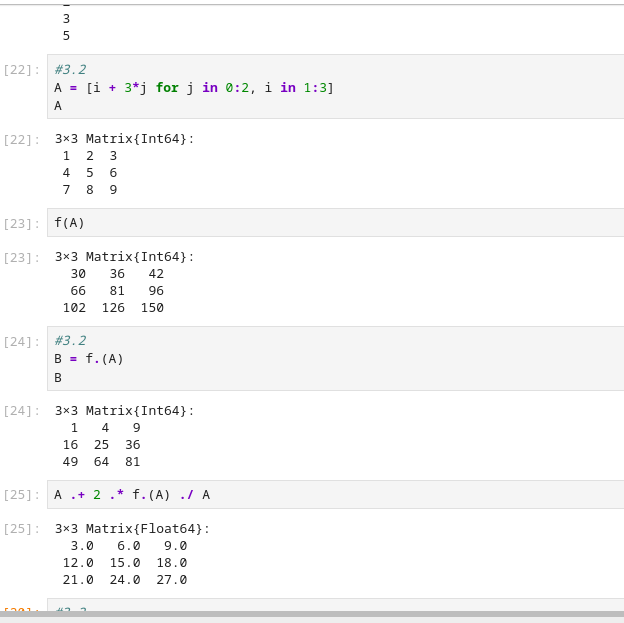{#fig-006 width=70%}

## Задания лабораторной работы

Выполняю добавление в Julia пакета Example(рис. @fig-007]) 

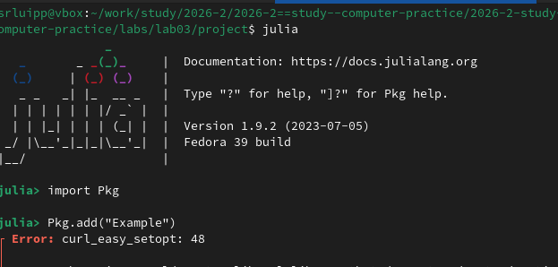{#fig-007 width=70%}

## Задания лабораторной работы

Тмк же добавляю пакет Colors ([рис. @fig-008]).

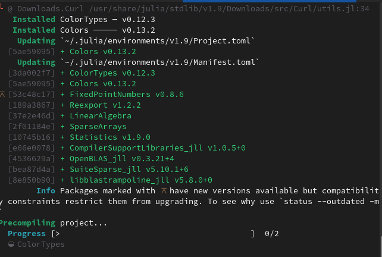{#fig-008 width=70%}

## Задания лабораторной работы

Повторяю пример с выводом цветовой палитры ([рис. @fig-009]).

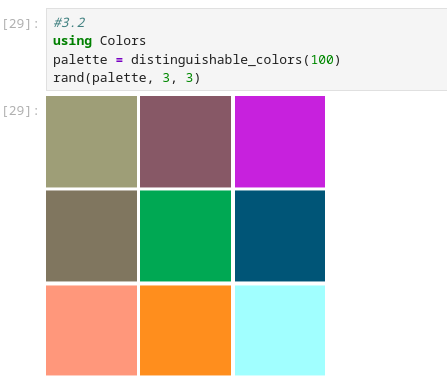{#fig-009 width=70%}

## Задания самостоятельной работы (№1)

Используя циклы while и for вывожу на экран целые числа от 1 до 100 и печатаю их квадраты;создаю словарь squares и массив squares_arr, содержащий квадраты всех чисел от 1 до 100 ([рис. @fig-010]) 

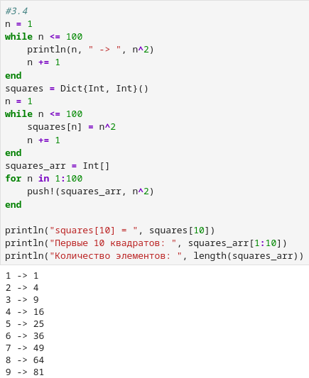{#fig-010 width=70%}

## Задания самостоятельной работы (№1)

([рис. @fig-011])

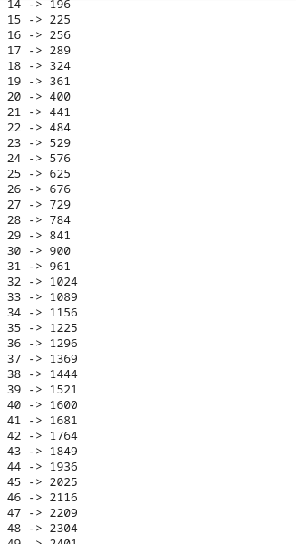{#fig-011 width=70%}

## Задания самостоятельной работы (№1)

([рис. @fig-012])  

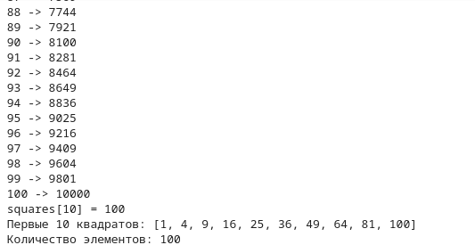{#fig-012 width=70%}

## №2 и №3

Пишу условный оператор, который печатает число, если число чётное, и строку
«нечётное», если число нечётное. Использую тернарный оператор. Для задания 3 пишу простое условие (функцию) добавление плюс одного значения ([рис. @fig-013])

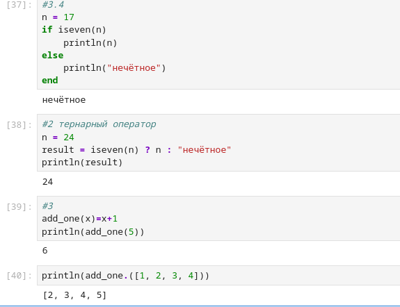{#fig-013 width=70%}

## №4

Использую map() или broadcast() для задания матрицы 𝐴, каждый элемент которой увеличивается на единицу по сравнению с предыдущим ([рис. @fig-014])

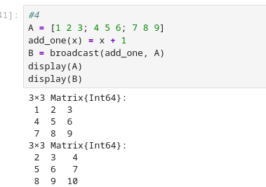{#fig-014 width=70%}

## №5

Задаю матрицу по заданию и возвожу ее в куб ([рис. @fig-015])

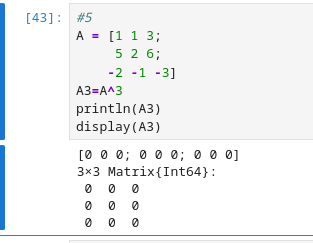{#fig-015 width=70%}

## №5

([рис. @fig-016])

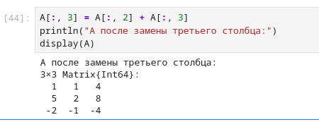{#fig-016 width=70%}

## №6

Создаю матрицу 𝐵 с элементами 𝐵𝑖1 = 10, 𝐵𝑖2 = −10, 𝐵𝑖3 = 10, 𝑖 = 1, 2, … , 15.
Вычисляю матрицу 𝐶 = 𝐵𝑇𝐵 ([рис. @fig-017])

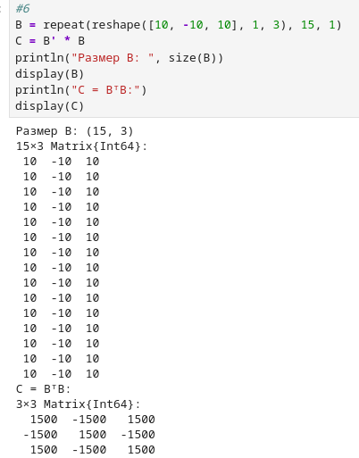{#fig-017 width=70%}

 ## 7

Создаю матрицу 𝑍 размерности 6 × 6, все элементы которой равны нулю, и матрицу
𝐸, все элементы которой равны 1. Используя цикл while или for и закономерности
расположения элементов, создаю матрицы размерности 6 × 6 ([рис. @fig-018])

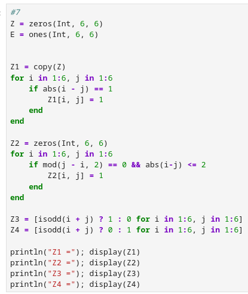{#fig-018 width=70%}

 ## 7
 
 ([рис. @fig-019]) 
 
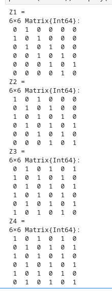{#fig-019 width=70%}

## №8

Работаю с функцией outer() (это матричное умножение с возможностью изменить применяемую операцию). Пишу свою функцию, аналогичную функции outer() с интерфейсом: outer(x,y,operation) ([рис. @fig-020]) 

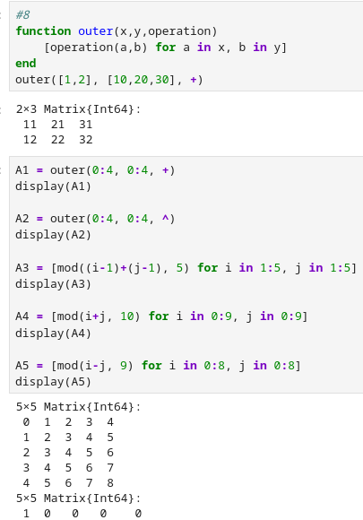{#fig-020 width=70%}

## №8

([рис. @fig-021])

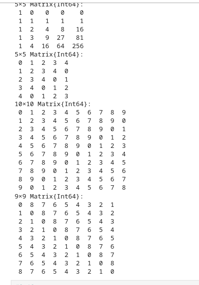{#fig-021 width=70%}

## №9

Решаю систему линейных уравнений с 5 неизвестными с помощью уравнения  Ax = 𝑦 ([рис. @fig-022]) 

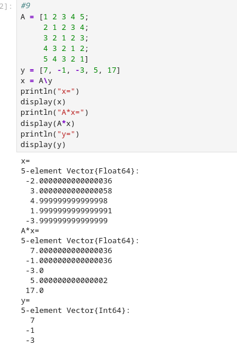{#fig-022 width=70%}

## №10

Создаю матрицу 𝑀 размерности 6 × 10, элементами которой являются целые числа,
выбранные случайным образом с повторениями из совокупности 1, 2, … , 10 и решаю еще некоторые условия по заданию  ([рис. @fig-023]) 

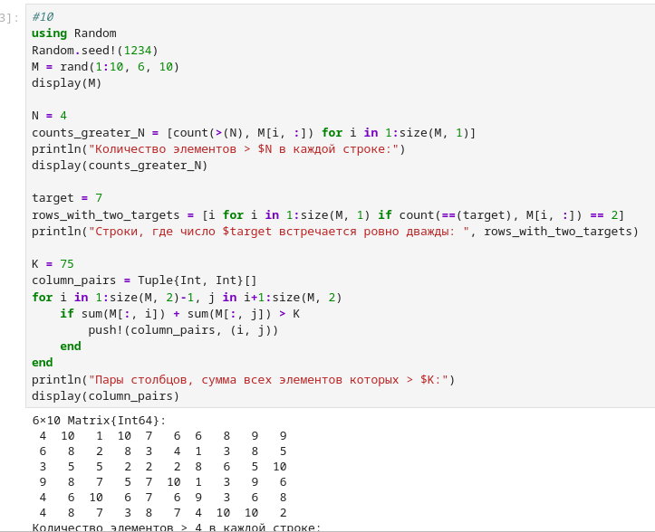{#fig-023 width=70%}

## №10

([рис. @fig-024]) 

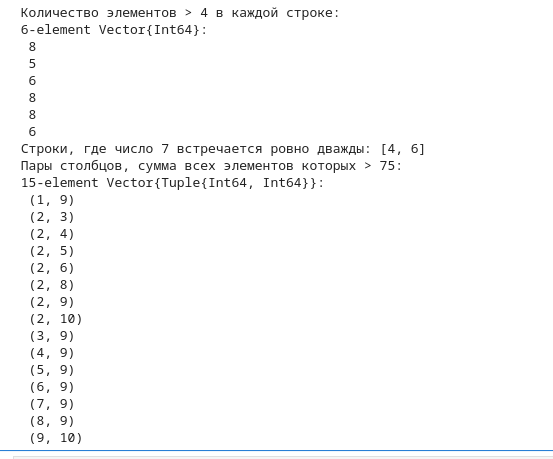{#fig-024 width=70%}

# Выводы

В результате получился ipynb файл с выполненными заданиями на языке Julia. В ходе работы я освоила применение циклов функций и сторонних для Julia пакетов для решения задач линейной алгебры и работы с матрицами.
