---
## Author
author:
  name: Люпп Софья Романовна
  degrees: BSc
  orcid: 0000-0002-0877-7063
  email: 1132236039@rudn.ru
  affiliation:
    - name: Российский университет дружбы народов
      country: Российская Федерация
      postal-code: 117198
      city: Москва
      address: ул. Миклухо-Маклая, д. 6
## Title
title: Презентация по лабораторной работе №4
subtitle: Линейная алгебра 
license: CC BY
date: today
date-format: "YYYY-MM-DD" # Example: 2025-09-06
---

# Информация

## Докладчик

:::::::::::::: {.columns align=center}
::: {.column width="70%"}

  * Люпп Софья Романовна
  * студентка группы НКНбд-01-23
  * кафедра теории вероятностей и кибербезопасности
  * Российский университет дружбы народов им. П. Лумумбы
  * [1132236039@rudn.ru]
  * <https://github.com/srluipp>

:::
::: {.column width="30%"}

:::
::::::::::::::

# Вводная часть

## Актуальность

Julia актуальна как инструмент для научных вычислений, финансового моделирования, искусственного интеллекта, вычислений в области инженерии и физики, благодаря своей высокой производительности, простоте синтаксиса и гибкости в работе с массивами и параллельным программированием

## Объект и предмет исследования

Язык программирования Julia и среда JupyterLab

## Цели и задачи

Основной целью работы является изучение возможностей специализированных пакетов Julia для выполнения и оценки эффективности операций над объектами линейной
алгебры.

# Выполнение лабораторной работы

Начинаю работу с воспроизведения результатов примеров из задания 4.2. Предварительно добавляю в Julia пакеты Statistics и BenchmarkTools([рис. @fig-001]) ([рис. @fig-002]).

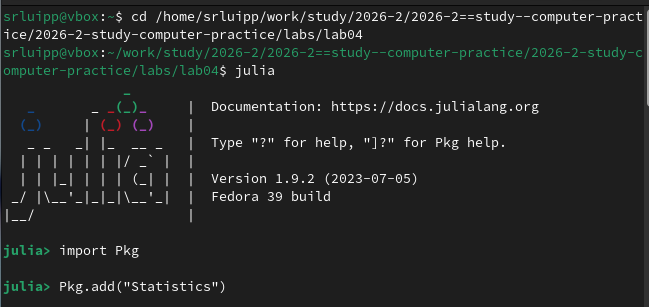{#fig-001 width=70%}

## BenchmarkTools

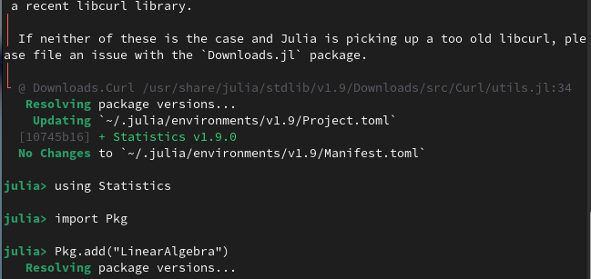{#fig-002 width=70%}

## Задания лабораторной работы

Для матрицы 4 × 3 рассмотрим поэлементные операции сложения, произведения её
элементов по строкам и столбцам, а так же нахожу средние значения ([рис. @fig-003])

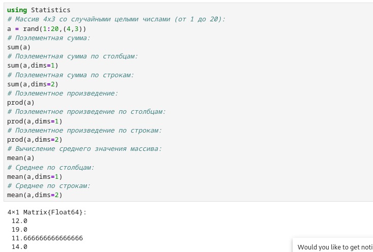{#fig-003 width=70%}

## Задания лабораторной работы

Для выполнения таких операций над матрицами, как транспонирование, диагонализация, определение следа, ранга, определителя матрицы и т.п. можно воспользоваться
библиотекой (пакетом) LinearAlgebra ([рис. @fig-004]) 

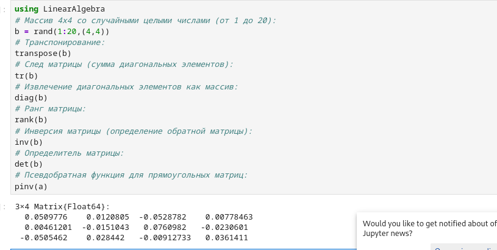{#fig-004 width=70%}

## Задания лабораторной работы

Вычисляю нормы векторов и матриц, повороты, вращения([рис. @fig-005]).
 
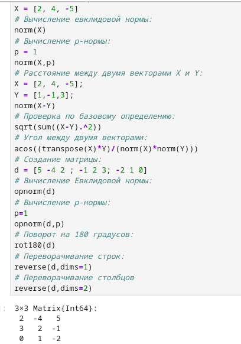{#fig-005 width=70%}

## Задания лабораторной работы

Выполняю задания на матричное умножение, единичная матрица, скалярное произведение ([рис. @fig-006]) 

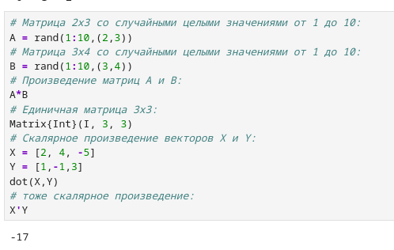{#fig-006 width=70%}

## Задания лабораторной работы

Для работы со специальными матричными структурами потребуется пакет LinearAlgebra.
Решение систем линейный алгебраических уравнений происходит через уравнение 𝐴𝑥 = b (рис. @fig-007]) 

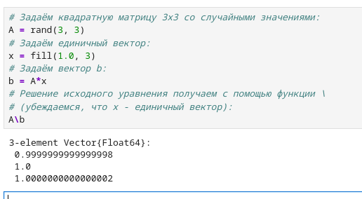{#fig-007 width=70%}

## Задания лабораторной работы

Julia позволяет вычислять LU-факторизацию и определяет составной тип факторизации
для его хранения: ([рис. @fig-008]).

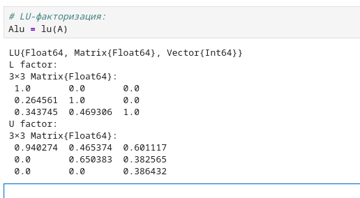{#fig-008 width=70%}

## Задания лабораторной работы

Создаем матрицу и вектор перестановок и решаем СЛАУ через матрицу и через факторизацию, вычисляем детерминант ([рис. @fig-009]).

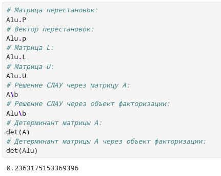{#fig-009 width=70%}

## Задания лабораторной работы

Выполняем QR-факторизацию ([рис. @fig-010]) ([рис. @fig-011]).

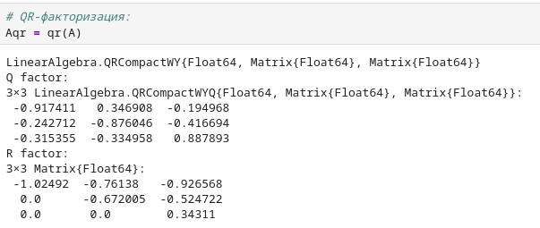{#fig-010 width=70%}

## R-факторизация

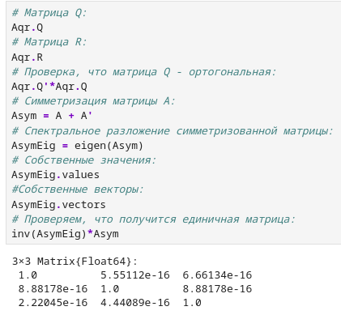{#fig-010 width=70%}

## Задания лабораторной работы

Проверяем, является ли матрица симметричной ([рис. @fig-012]).

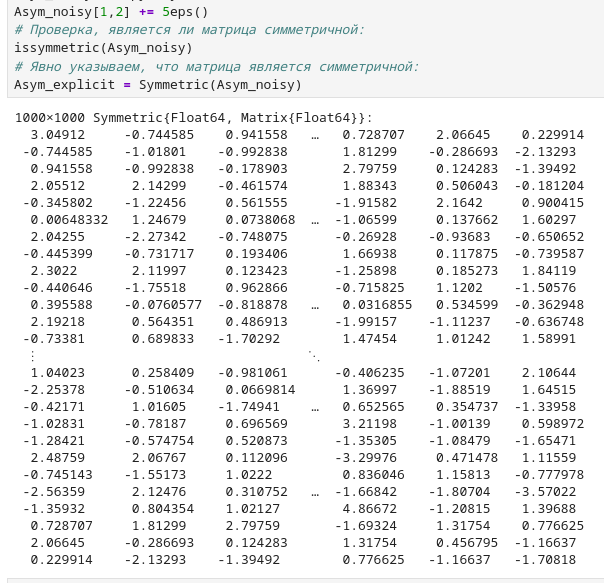{#fig-012 width=70%}

## Задания лабораторной работы

Добавляем пакет Julia Benchmarks ([рис. @fig-013]).

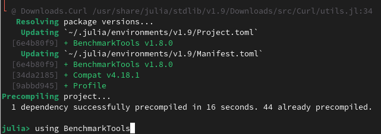{#fig-013 width=70%}

## Задания лабораторной работы

Оцениваю эффективность выполнения операции по нахождению собственных значений ([рис. @fig-014])

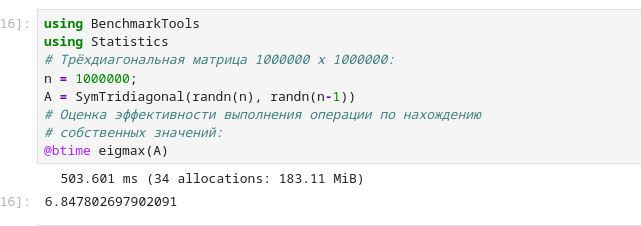{#fig-014 width=70%}

## Задания лабораторной работы

Решаю систему линейных уравнений с рациональными элементами без преобразования в типы элементов с плавающей запятой (для избежания проблемы с переполнением используем BigInt) ([рис. @fig-015])

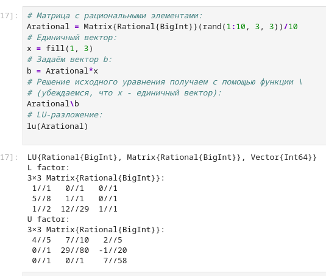{#fig-015 width=70%}

## Задания самостоятельной работы (№1)

Вывожу вектор v, после чего для него выполняю умножение на него самого себя векторно и матрично ([рис. @fig-016])

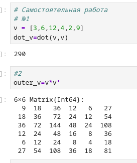{#fig-016 width=70%}

## №2

Выполняю код для решения СЛАУ ([рис. @fig-017])

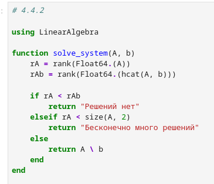{#fig-017 width=70%}

 ## №2

Решение систем линейных уравнений ([рис. @fig-018])([рис. @fig-019]) 

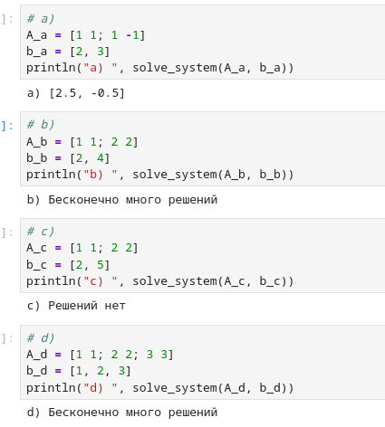{#fig-018 width=70%}

 ## Решение систем линейных уравнений 

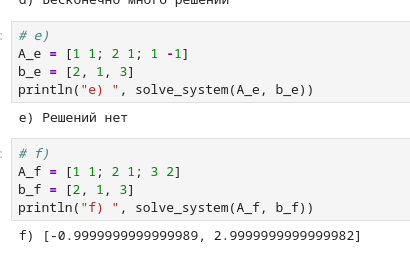{#fig-019 width=70%}

## №2

Решаю систему линейных уравнений с тремя неизвестными ([рис. @fig-020]) 

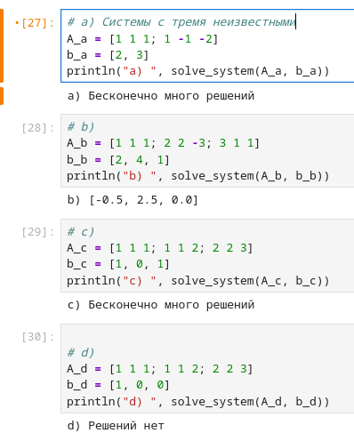{#fig-020 width=70%}

## №3

По заданию привожу матрицы к диагональному виду ([рис. @fig-021])
 
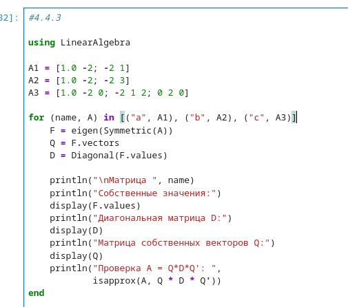{#fig-021 width=70%}

## №3

Вывод собственных значений матриц и их диагональный вид ([рис. @fig-022]) ([рис. @fig-023]).

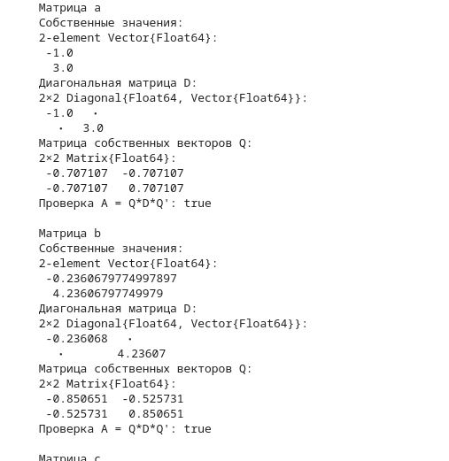{#fig-022 width=70%}

## диагональный вид

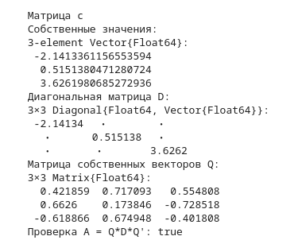{#fig-023 width=70%}

## №3

Выполняю вычисление над матрицами по заданию ([рис. @fig-024]) ([рис. @fig-025]) 

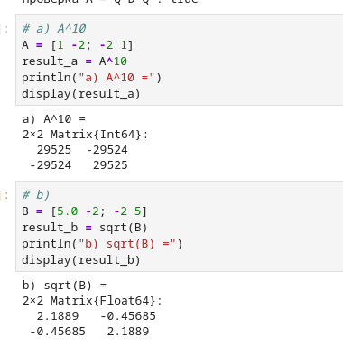{#fig-024 width=70%}

## вычисление над матрицами по заданию

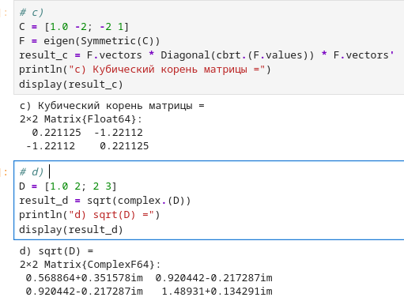{#fig-025 width=70%}

## №3

Найдожу собственные значения матрицы 𝐴, привожу ее к диагональному виду, создаю нижнедиагональную матрицу ([рис. @fig-026]) .

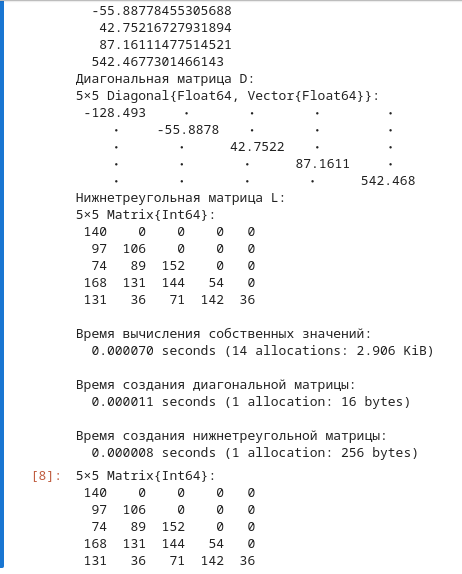{#fig-026 width=70%}

## №4

Матрица 𝐴 называется продуктивной, если решение 𝑥 системы при любой неотрицательной правой части 𝑦 имеет только неотрицательные элементы 𝑥𝑖. Используя это
определение, проверяю, являются ли матрицы продуктивными ([рис. @fig-027]) .

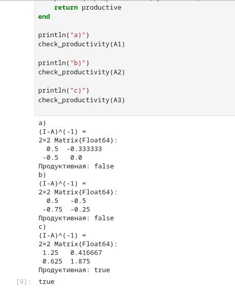{#fig-027 width=70%}

## №4

Используя другой критерий продуктивности (𝐸 − 𝐴)−1, проверяю, являются ли матрицы продуктивными ([рис. @fig-028]).

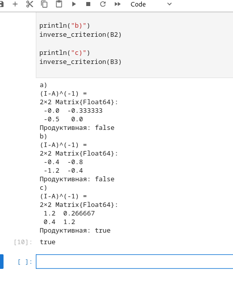{#fig-028 width=70%}

## №4

Спектральный критерий продуктивности: матрица 𝐴 является продуктивной тогда
и только тогда, когда все её собственные значения по модулю меньше 1. Используя
этот критерий, проверяю, являются ли матрицы продуктивными([рис. @fig-029]).

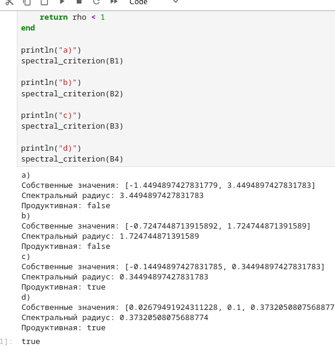{#fig-029 width=70%}

# Выводы

В ходе лабораторной работы я изучила возможности специализированных пакетов Julia для выполнения и оценки эффективности операций над объектами линейной алгебры.
