---
## Author
author:
  name: Люпп Софья Романовна
  degrees: BSc
  orcid: 0000-0002-0877-7063
  email: 1132236039@rudn.ru
  affiliation:
    - name: Российский университет дружбы народов
      country: Российская Федерация
      postal-code: 117198
      city: Москва
      address: ул. Миклухо-Маклая, д. 6
## Title
title: Презентация по лабораторной работе №6
subtitle: Решение моделей в непрерывном и дискретном времени
license: CC BY
date: today
date-format: "YYYY-MM-DD" # Example: 2025-09-06
---

# Информация

## Докладчик

:::::::::::::: {.columns align=center}
::: {.column width="70%"}

  * Люпп Софья Романовна
  * студентка группы НКНбд-01-23
  * кафедра теории вероятностей и кибербезопасности
  * Российский университет дружбы народов им. П. Лумумбы
  * [1132236039@rudn.ru]
  * <https://github.com/srluipp>

:::
::: {.column width="30%"}

:::
::::::::::::::

# Вводная часть

## Актуальность

Julia актуальна как инструмент для научных вычислений, финансового моделирования, искусственного интеллекта, вычислений в области инженерии и физики, благодаря своей высокой производительности, простоте синтаксиса и гибкости в работе с массивами и параллельным программированием

## Объект и предмет исследования

Язык программирования Julia и среда JupyterLab

## Цели и задачи

Основной целью работы является освоение специализированных пакетов для решения
задач в непрерывном и дискретном времени.

# Выполнение лабораторной работы

Начинаю работу с воспроизведения результатов примеров из задания 6.2. Предварительно добавляю в Julia пакеты. Строю модель экспоненциального роста 𝑢(𝑡) = 𝑎𝑢(𝑡), 𝑢(0) = 𝑢0 ([рис. @fig-001]) 
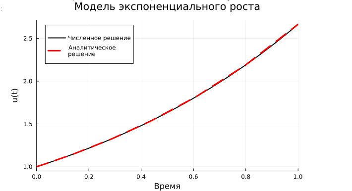{#fig-001 width=70%}

# Выполнение лабораторной работы

([рис. @fig-002]).

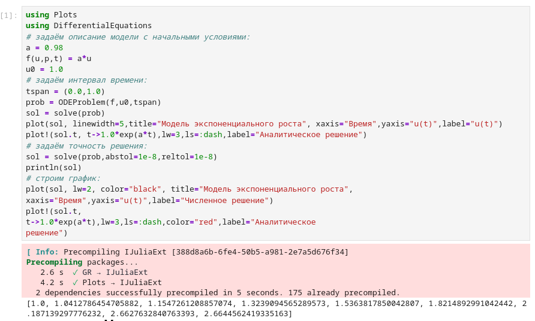{#fig-002 width=70%}

## Задания лабораторной работы

Строю аттракцион Лоренца.
Система описывает движение потоков в плоском слое жидкости постоянной толщины при разложении
скорости течения и температуры в двойные ряды Фурье с последующем усечением до
первых-вторых гармоник. ([рис. @fig-003])

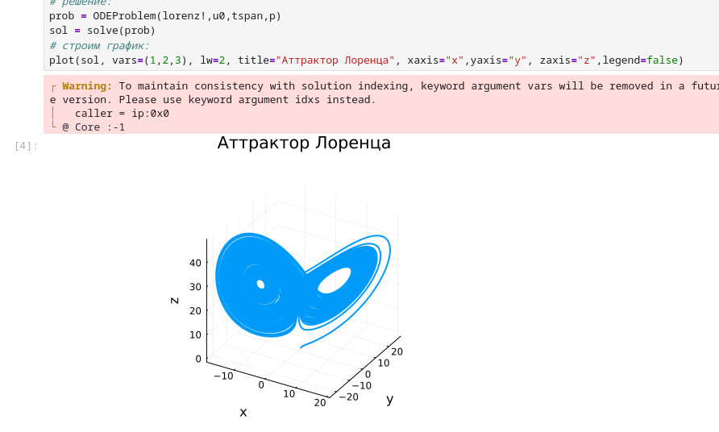{#fig-003 width=70%}

## Задания лабораторной работы

 Аттракцион Лоренца с отключенной интерполяцией ([рис. @fig-004]) 

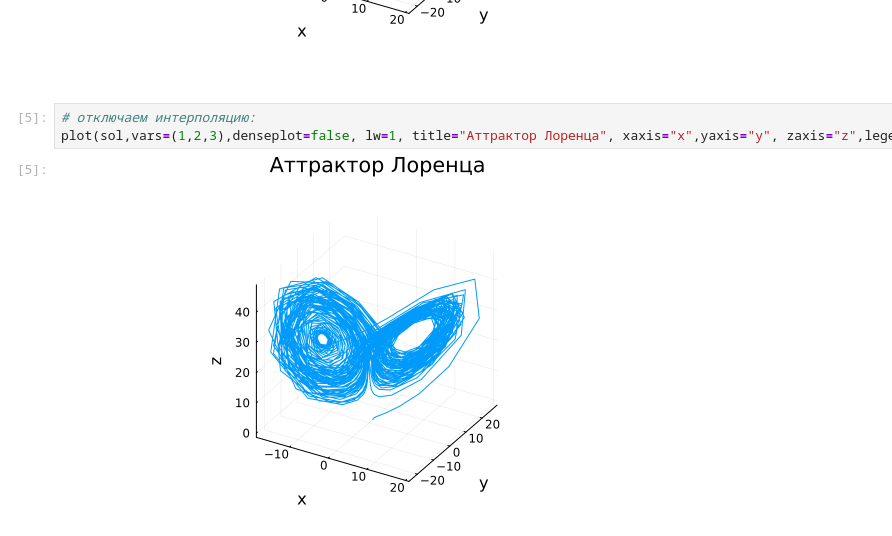{#fig-004 width=70%}

## Задания лабораторной работы

Модель Лотки–Вольтерры описывает взаимодействие двух видов типа «хищник – жертва»:
{
̇𝑥 = (𝛼 − 𝛽𝑦)𝑥,
̇𝑦 = (−𝛾 + 𝛿𝑥)𝑦,
где 𝑥 — количество жертв, 𝑦 — количество хищников,𝑡 — время, 𝛼, 𝛽, 𝛾, 𝛿 — коэффициенты, отражающие взаимодействия между видами (в данном случае 𝛼 — коэффициент
рождаемости жертв, 𝛾 — коэффициент убыли хищников, 𝛽 — коэффициент убыли жертв
в результате взаимодействия с хищниками, 𝛿 — коэффициент роста численности хищников).
([рис. @fig-005]).
 
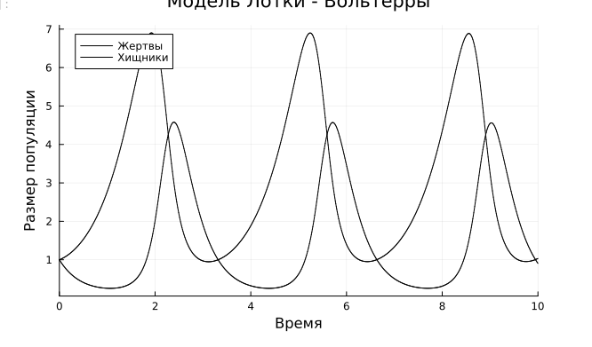{#fig-005 width=70%}

## Задания лабораторной работы

Фазовый портрет модели Лотки-Вольтерры ([рис. @fig-006]) 

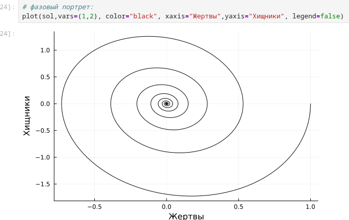{#fig-006 width=70%}

## Задания самостоятельной работы

Реализую и проанализирую модель роста численности изолированной популяции (модель Мальтуса):
где 𝑥(𝑡) — численность изолированной популяции в момент времени 𝑡, 𝑎 — коэффициент роста популяции, 𝑏 — коэффициент рождаемости, 𝑐 — коэффициент смертности (рис. @fig-007]) 

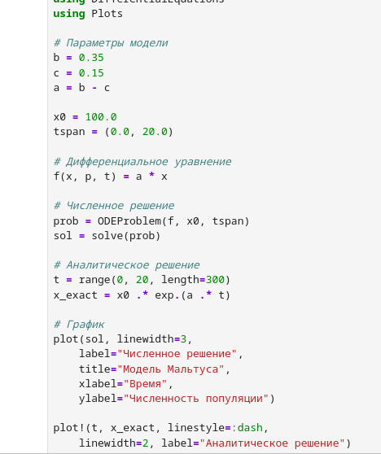{#fig-007 width=70%}

## Задания лабораторной работы

Модель Мальтуса ([рис. @fig-008]).

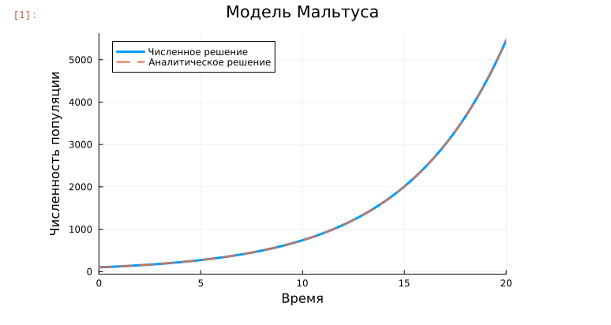{#fig-008 width=70%}

## Задания лабораторной работы

Анимация модели Мальтуса ([рис. @fig-009]).

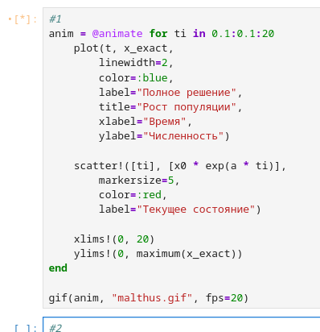{#fig-009 width=70%}

## Задания лабораторной работы

Анимация модели Мальтуса ([рис. @fig-010]) .

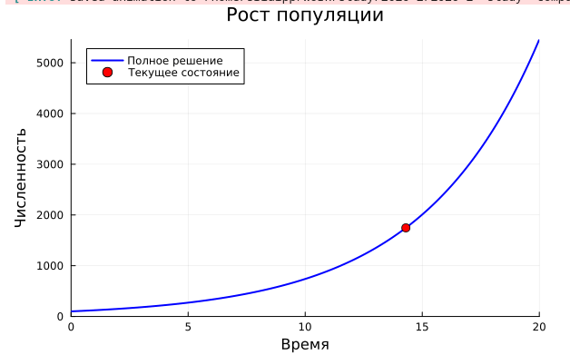{#fig-010 width=70%}

## Задания лабораторной работы

Реализую и проанализирую логистическую модель роста популяции, где 𝑟 — коэффициент роста популяции, 𝑘 — потенциальная ёмкость экологической системы (предельное значение численности популяции) ([рис. @fig-011]).

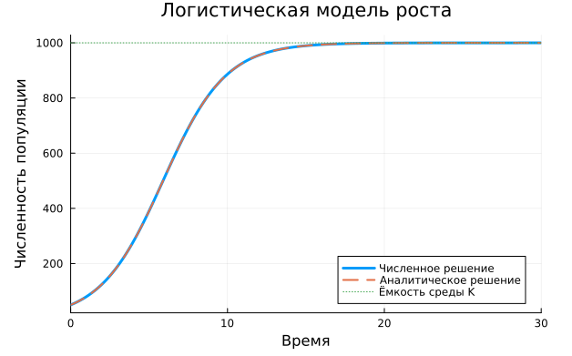{#fig-011 width=70%}

## Задания лабораторной работы

Анимация логистической модели ([рис. @fig-012]).

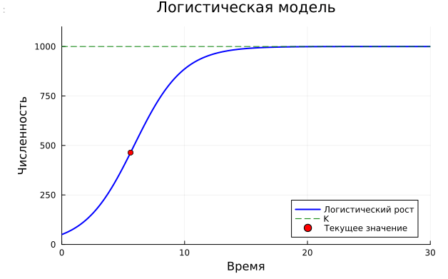{#fig-012 width=70%}

## Задания лабораторной работы

Параметры логистической модели ([рис. @fig-013]).

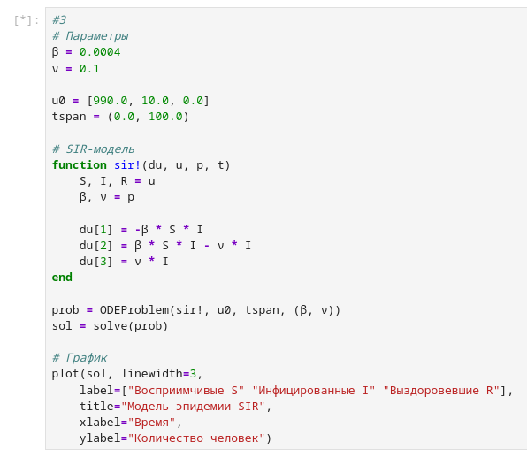{#fig-013 width=70%}

## Задания лабораторной работы

Реализую и проанализирую модель эпидемии Кермака–Маккендрика (SIRмодель), где 𝑠(𝑡) — численность восприимчивых к болезни индивидов в момент времени
𝑡, 𝑖(𝑡) — численность инфицированных индивидов в момент времени 𝑡, 𝑟(𝑡) —
численность переболевших индивидов в момент времени 𝑡 ([рис. @fig-014])

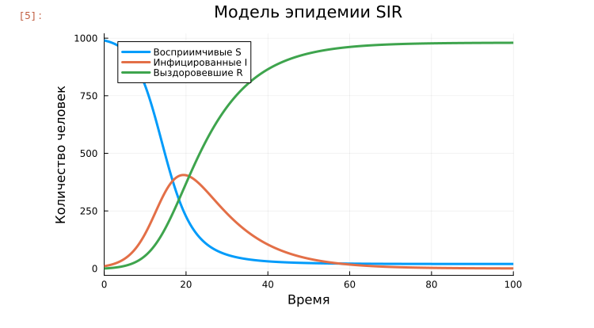{#fig-014 width=70%}

## Задания лабораторной работы

Анимация модели Кермака–Маккендрика ([рис. @fig-015])

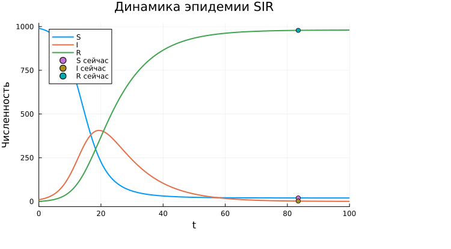{#fig-015 width=70%}

## Задания лабораторной работы 

Реализую график SEIR, как расширение модели SIR (Susceptible-Infected-Removed) по результатам эпидемии испанки (Susceptible-Exposed-Infected-Removed)([рис. @fig-016])

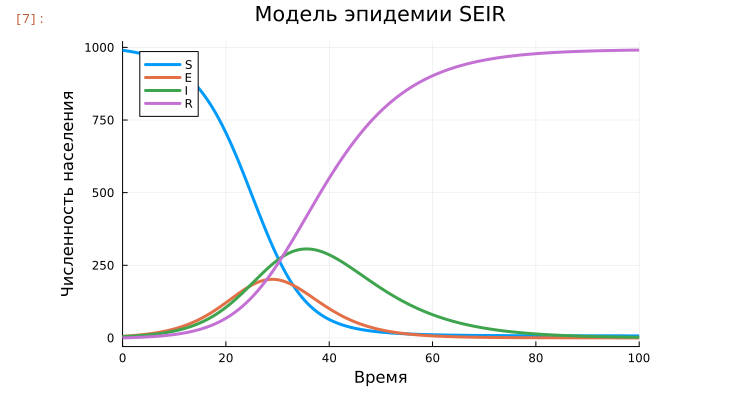{#fig-016 width=70%}

## Задания лабораторной работы

Код модели  SEIR ([рис. @fig-017])

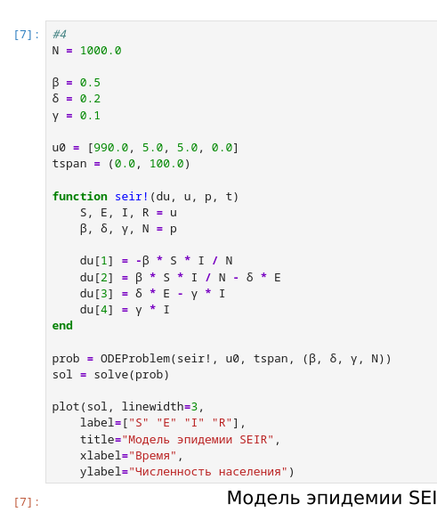{#fig-017 width=70%}

 ## Задания лабораторной работы

 Код модели  SIR ([рис. @fig-018])
 
 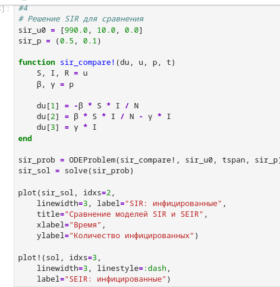{#fig-018 width=70%}
 
 ## Задания лабораторной работы
  
Сравнение моделей  SEIR и  SIR ([рис. @fig-019]) 

[Сравнение моделей](image/19.png){#fig-019 width=70%}

## Задания лабораторной работы

Нахожу точку равновесия для дискретной модели Лотки-Вольтерры и сравниваю аналитическое и численное решения ([рис. @fig-020]) 

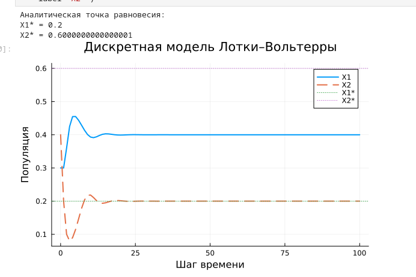{#fig-020 width=70%}

## Задания лабораторной работы

Код модели Лотки-вольтерры ([рис. @fig-021])
 
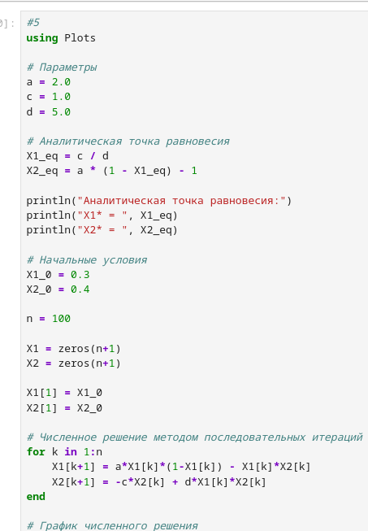{#fig-021 width=70%}

## Задания лабораторной работы

Фазовый портрет дискретной модели ([рис. @fig-022]) 
 
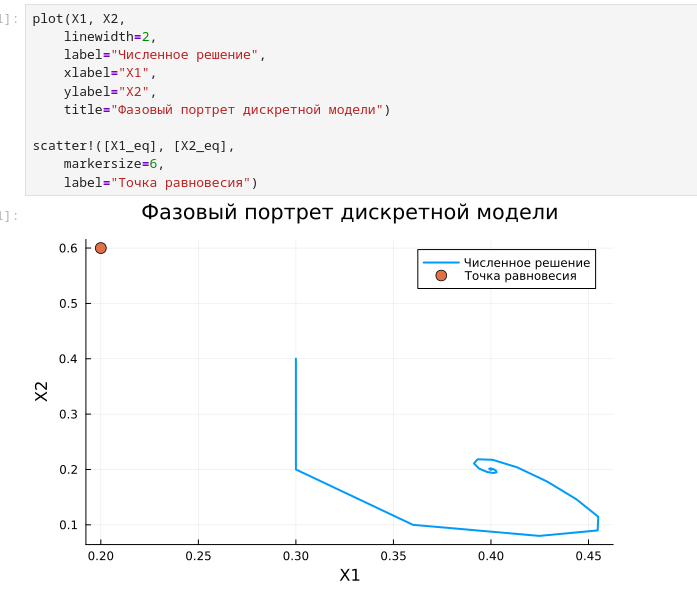{#fig-022 width=70%}
 
 ## Задания лабораторной работы
 
 Реализую модель отбора на основе конкурентных отношений ([рис. @fig-023]).

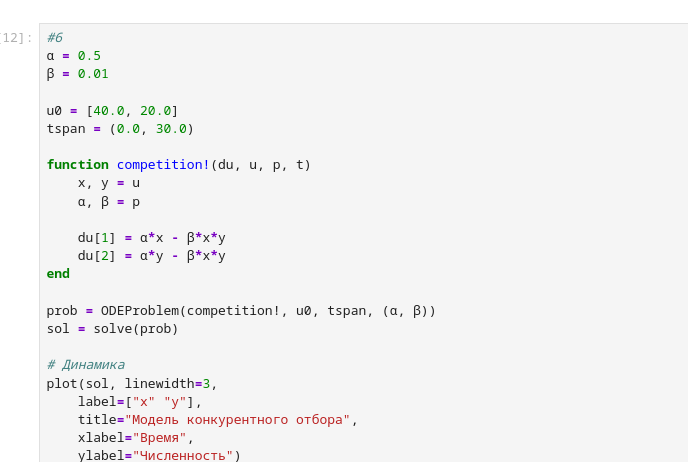{#fig-023 width=70%}

## Задания лабораторной работы

Модель отбора конкурентных отношений и ее фазовый портрет ([рис. @fig-024]) 

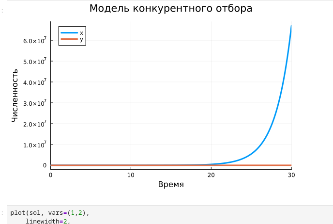{#fig-024 width=70%}

## Задания лабораторной работы

([рис. @fig-025]) 

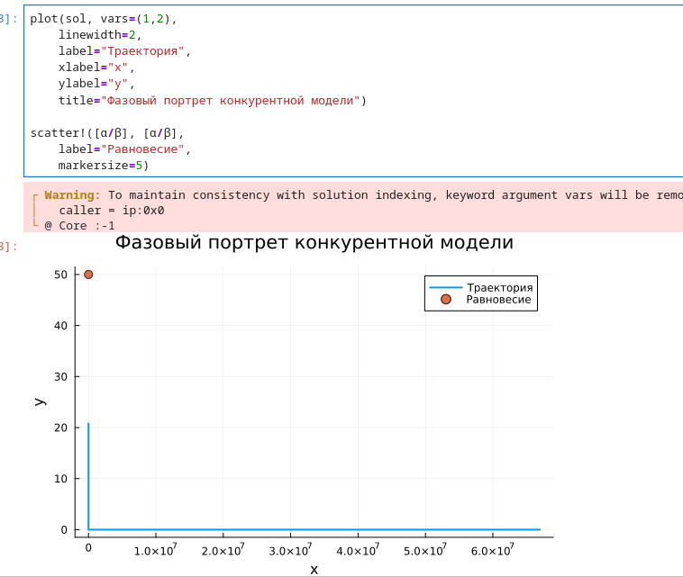{#fig-025 width=70%}

## Задания лабораторной работы

Делаю анимацию ([рис. @fig-026]) .

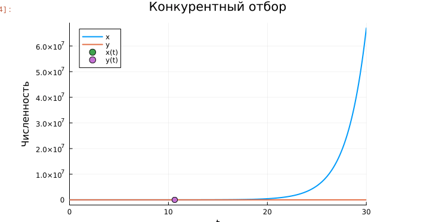{#fig-026 width=70%}

## Задания лабораторной работы

Реализую  модель консервативного гармонического осциллятора, где 𝜔0 — циклическая частота([рис. @fig-027]) .

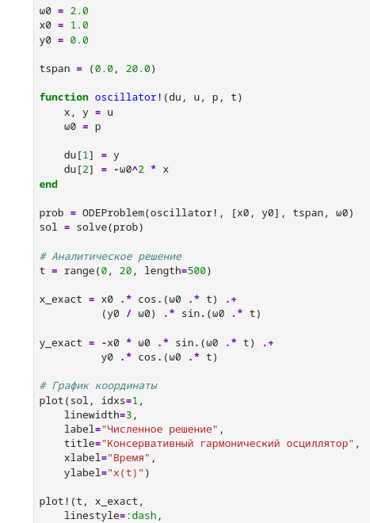{#fig-027 width=70%}

## Задания лабораторной работы

График гармонического осциллятора ([рис. @fig-028]).

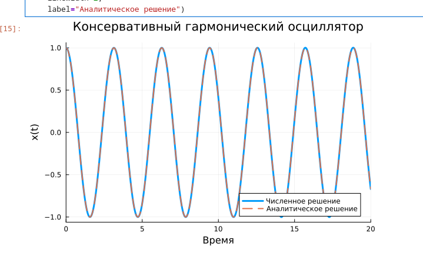{#fig-028 width=70%}

##  Задания лабораторной работы

Фазовый портрет осциллятора ([рис. @fig-029]).

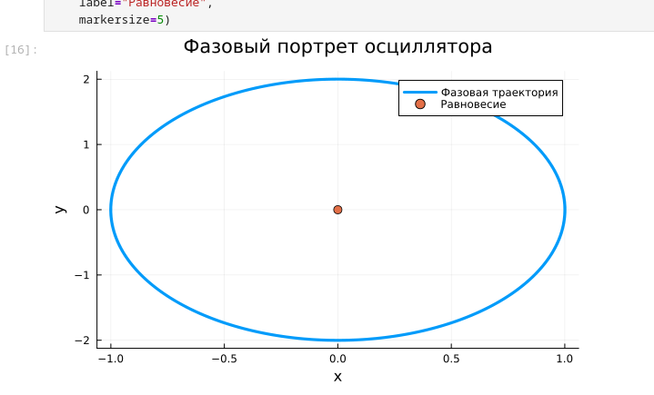{#fig-029 width=70%}

##  Задания лабораторной работы

делаю анимацию ([рис. @fig-030]).

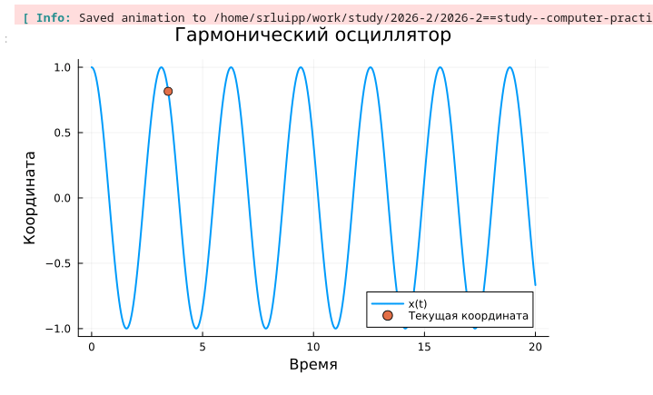{#fig-030 width=70%}

##  Задания лабораторной работы

Реализую модель свободных колебаний гармонического осциллятора,
где 𝜔0 — циклическая частота, 𝛾 — параметр, характеризующий потери энергии([рис. @fig-031]).

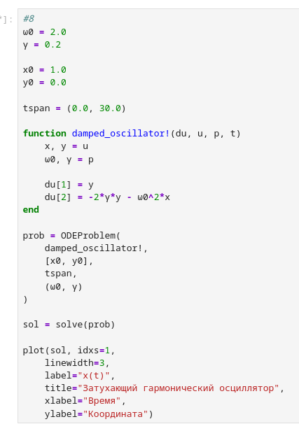{#fig-031 width=70%}

##  Задания лабораторной работы

График модели свободных колебаний ([рис. @fig-032]).

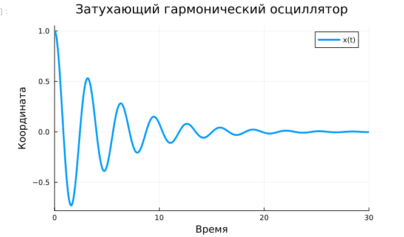{#fig-032 width=70%}

##  Задания самостоятельной работы

Фазовый портрет модели свободных колебаний осциллятора([рис. @fig-033]).

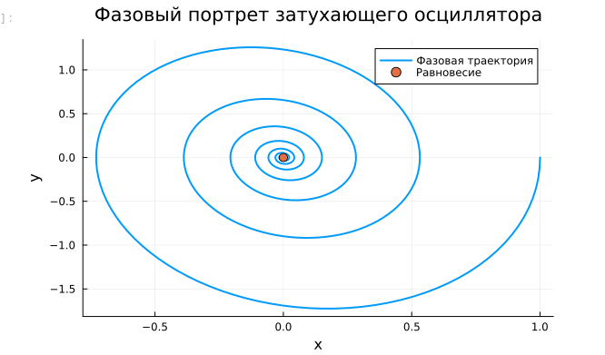{#fig-033 width=70%}

##  Задания самостоятельной работы

Денлаю анимацию ([рис. @fig-034]).

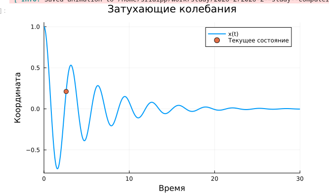{#fig-034 width=70%}

# Выводы

В ходе лабораторной работы я освоила специализированные пакеты для решения
задач в непрерывном и дискретном времени.
